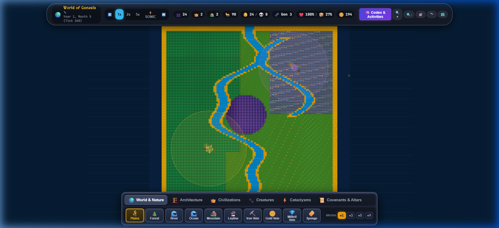
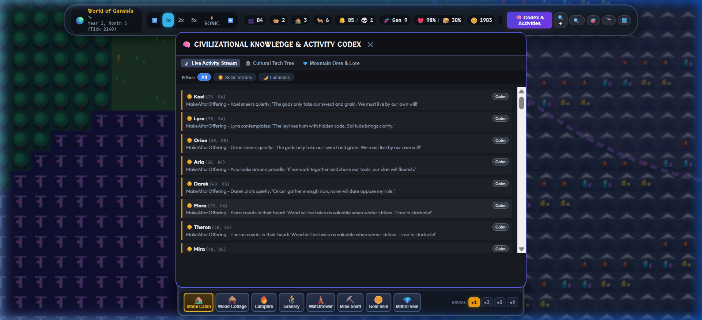
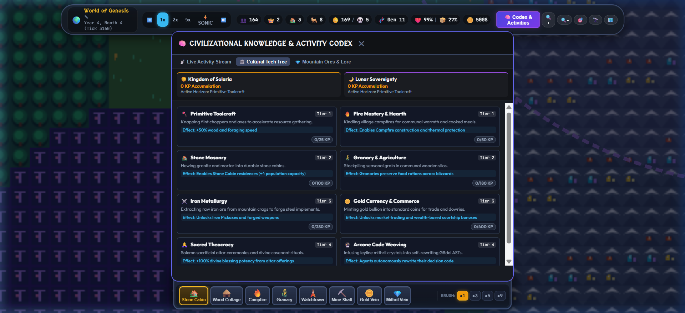
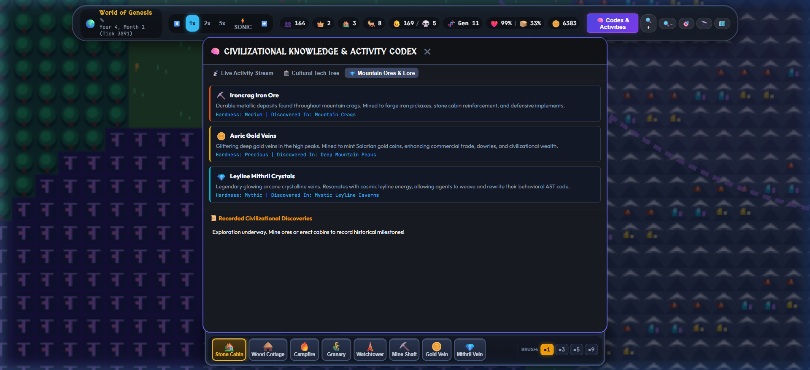
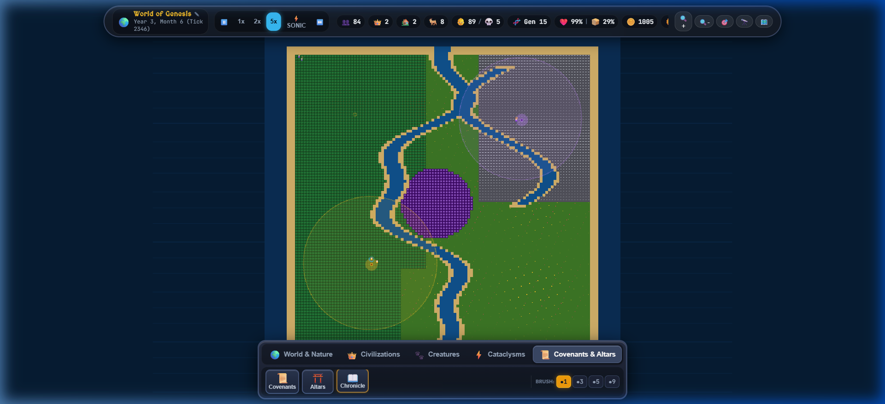
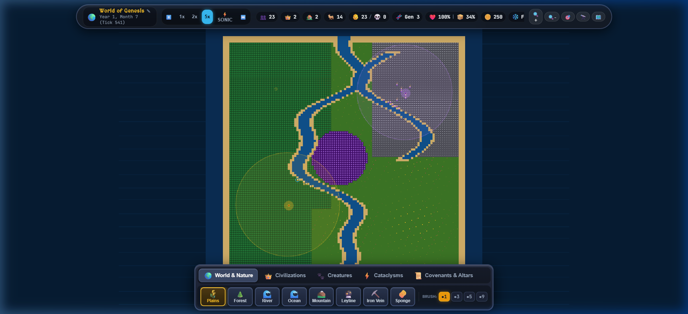
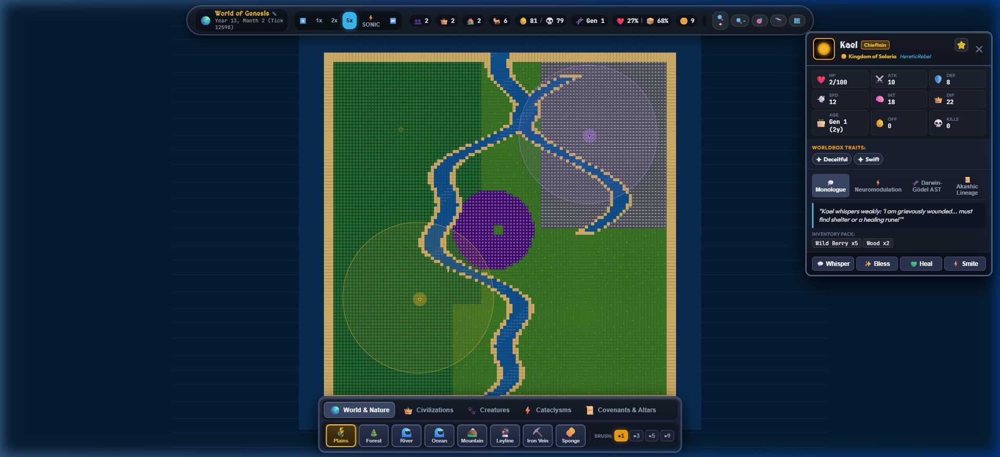
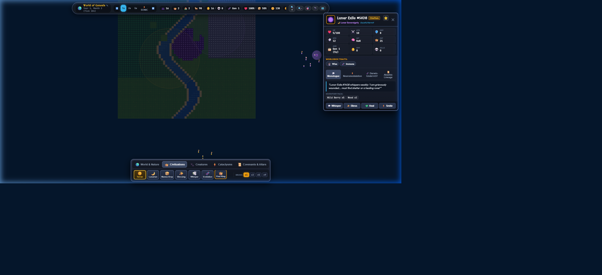

# ✦ Genesis Cogniverse
### Autonomous Neuro-Symbolic Self-Learning AI RPG World & WorldBox God Pantheon Engine in Pure Rust

[](https://www.rust-lang.org/)
[](LICENSE)
[]()
[]()
[]()

> **Genesis Cogniverse** is a persistent, CPU-optimized artificial life simulation and fantasy RPG sandbox inspired by **WorldBox**, where **every entity is an autonomous, self-learning AI**. Non-player characters (NPCs) live with absolute free will, gather resources, build cabins, present altar offerings, mate, experience biological neuromodulation, and **recursively rewrite their own decision code over generations** using fuel-metered Abstract Syntax Trees (ASTs).

---

## 📸 WorldBox-Inspired God Admin Console


*Live 2D Procedural Matrix (**128x128 Grand Continental Archipelago - 16,384 tiles**) showcasing defined, distinguishable pixel biomes, permanent village structures (**Stone Cabins with pitched roofs and chimneys, Thatched Cottages, Campfires, Granaries, Watchtowers, and Mountain Mine Shafts**), and discoverable mountain ore veins (**Glittering Auric Gold, Radiant Cyan Mithril, and Metallic Copper Iron**).*


*Dedicated **🧠 Knowledge & Activities Codex Modal** featuring a real-time Live Activity Stream tracking agent coordinates, behavioral actions, inner monologue thoughts, and Kenji Doya emotional states (`Inspired`, `Content`, `Vigilant`, `Distressed`, `Calm`).*


*8-Tier Civilizational Technology Progression Tree (**Primitive Toolcraft, Fire Mastery & Hearth, Stone Masonry, Granary & Agriculture, Iron Metallurgy, Gold Currency & Commerce, Sacred Theocracy, Arcane Code Weaving**) driven by autonomous knowledge point accrual from mining and building.*


*Mountain Ores & Discoveries Archive detailing geological properties, hardness ratings, and historical civilizational milestones recorded by exploring pioneers.*


*Live 2D Procedural Matrix running at **5x Sonic Speed** at **Tick 2,346 (Year 3, Month 6)**. Demonstrates complete resolution of riverbank clumping with thriving settlement anchoring: **👥 84 citizens, 👶 89 births / 💀 5 deaths, 🧬 Generation 15**.*


*Early demographic growth phase with expanding territorial borders (`☀️ Kingdom of Solaria` golden realm vs `🌙 Lunar Sovereignty` violet realm).*


*Detailed bird's eye view with boundless deep ocean backdrop, dual winding rivers (Great Crystal River + Mountain Tributary), sandy coastal shelves, Ironcrag Mountain Spine, Whispering Redwood Forest, Ancient Leyline Ruins, and autonomous settlements.*


*Authentic WorldBox Character Sheet Modal featuring character portrait, noble titles (`Chieftain`, `HereticRebel`), kingdom affiliation, favorite star (⭐), core RPG stats matrix (`HP`, `ATK`, `DEF`, `SPD`, `INT`, `DIP`, `AGE`, `OFF`, `KILLS`), WorldBox Trait Badges (`✦ Deceitful`, `✦ Swift`, `✦ Strong`), tabbed cognition (Inner Monologue, Kenji Doya Neuromodulators, Darwin-Gödel AST, Akashic Lineage), inventory items, and God powers (`💬 Whisper`, `✨ Bless`, `💚 Heal`, `⚡ Smite`).*

> [!TIP]
> ### 📸 User Screenshot Requests (Recent Updates)
> Please capture and add the following screenshots to the `screenshots/` directory to document the latest systems:
> 1. **Control + Click & Hold Panning & WorldBox Cursor** (`screenshots/worldbox_ctrl_click_panning.png`): Hold `Control` (or `Cmd`) on the Canvas map showing the dynamic `grab` / `grabbing` cursor while smoothly panning across the continent.
> 2. **Cellular Lava & Basalt Solidification** (`screenshots/worldbox_lava_basalt_dynamics.png`): Drop molten lava into shallow water or ocean using the `🌋 Lava` tool and capture the animated magma glow and cooling into dark basalt rock.
> 3. **Spreading Wildfire & Ash Decals** (`screenshots/worldbox_cellular_wildfire.png`): Ignite a forest using the `🔥 Wildfire` tool and capture the flame animations, smoke particles, and charred ash ground.
> 4. **Freeze Ice & Walkable Frozen Waters** (`screenshots/worldbox_freeze_ice_walking.png`): Freeze river or coastal tiles using the `🧊 Freeze Ice` tool showing characters walking across the solid ice sheets.
> 5. **Live Plots & Rebellions Codex Tab** (`screenshots/codex_plots_rebellions.png`): Open the Codex (`🧠 Codex & Activities`) and switch to the `⚔️ Live Plots & Rebellions` tab showing active civil plots, conspirators, treasuries, and progress bars.
> 6. **Monumental Town Hall & Barracks Architecture** (`screenshots/worldbox_townhall_barracks.png`): Place a Town Hall and Barracks using the `🏗️ Architecture` tool tray near a village center and capture their pixel-art rendering.
> 7. **World Archetypes & Generation Forge Modal** (`screenshots/worldbox_world_management_modal.png`): Open the `🌍 Worlds & Maps` modal showing the 7 archetype cards, seed randomizer, sea level & mountain ruggedness sliders, and dual divine Reset / Forge action buttons.
> 8. **Sovereign Radar Minimap** (`screenshots/minimap_radar_active.png`): Overview radar HUD showing full-realm territory colors, camera view rectangle, and boss pings.
> 9. **Sovereign War Room & Titan Dossier** (`screenshots/war_room_titan_codex.png`): War Room modal showcasing territorial sovereignty balance, active siege artillery list, and Primordial Titan health dossiers.
> 10. **Audio Fidelity & Realm Settings** (`screenshots/realm_settings_audio_modal.png`): Settings modal with Master, SFX, and Ambient sliders, mute button, and visual toggles.

---

## 🔬 Reverse Engineering WorldBox & REA Toolchain Integration

We integrated the **Reverse Engineer Anything (REA)** skills framework (`git@github.com:morluto/rea.git`) into our workspace and global configuration, registering the REA MCP server for live autonomous inspection:
* **REA Skill Bundle**: Configured at `.agents/skills/reverse-engineer-anything/` and `~/.gemini/config/skills/reverse-engineer-anything/`.
* **REA MCP Server**: Registered in `~/.gemini/config/mcp_config.json` via `npx -y rea-agents@latest mcp`.
* **Binary Decompilation**: Used `ilspycmd` (v11.1.0 on .NET 10) on decompiled game runtime binaries (`Assembly-CSharp.dll`).

### WorldBox Architectural Systems Reverse-Engineered & Adapted

| WorldBox C# System | Decompiled Structure & Mechanics | Cogniverse Rust Engine Equivalent |
|---|---|---|
| **`TileLibrary` & `MapGenerator`** | 9-layer elevation hierarchy (`deep_ocean`, `close_ocean`, `shallow_waters`, `sand`, `soil_low`, `soil_high`, `hills`, `mountains`, `summit`) generated via multi-octave Perlin noise with radial distance falloff. | **`ElevationLayer` & `MapGenerator` (`src/world/tile.rs`, `src/world/generation.rs`)**: 9-tier elevation hierarchy with continental distance falloff mask, coherent noise, mountain spring pools, and non-potable outer ocean margins. |
| **`WorldBehaviourActionFire`** | Spreads across flammable materials (trees, grain, wood buildings) based on moisture and heat; water tiles extinguish immediately; leaves burned ground that decays to ash before regenerating fertility. | **`CellularAutomataEngine::tick_fire` (`src/world/cellular.rs`)**: Cellular wildfire engine with neighbor ignition, fuel consumption, structure fire damage, ash recovery stages (`burned_stages`), and animated flame particles in `static/app.js`. |
| **`WorldBehaviourActionLava`** | Molten lava flows downhill into lower adjacent elevations, melts frozen ice, destroys wood structures, and **solidifies into basalt stone (`TileLibrary.hills`) when touching water**. | **`CellularAutomataEngine::tick_lava` (`src/world/cellular.rs`)**: Molten lava cellular automata with downhill gravity flow, temperature spikes (95°C), and basalt rock/hills formation upon water contact. |
| **`WorldBehaviourTilesTemperatureFreeze`** | Temperature diffusion where subzero temperatures freeze shallow waters into walkable ice sheets, snow caps summits, and warm heat melts ice back into water. | **`CellularAutomataEngine::tick_freeze_thaw` (`src/world/cellular.rs`)**: Dynamic temperature model where shallow waters freeze into solid walkable ice (`FrozenState::Ice`), enabling entities to walk across bodies of water. |
| **`WorldBehaviourActionBiomes`** | Biomes compete and creep into neighboring tiles based on `grow_strength` ratings (`Randy.randomInt`). | **`CellularAutomataEngine::tick_biome_creep` (`src/world/cellular.rs`)**: Stochastic competitive biome creeping for Savanna, Lush Jungle, Corrupted Infernal, and Permafrost Tundra. |
| **`PlotsLibrary` / `PlotAsset`** | Conspirators gather ambition, initiate schemes (Rebellion, War, Alliance, Secession), tick progress toward a threshold, and trigger diplomatic shifts. | **`CivilPlot` & `PlotType` (`src/factions/plots.rs`)**: Emergent political plots (`Rebellion`, `HolyWar`, `CommercialAlliance`, `HeresySchism`, `GoldenAgePact`) driven by faction treasuries, mutual sentiment, and conspirator counts. |
| **`ActorTraitLibrary` / `ActorTrait`** | Traits possess `rate_birth`, `rate_inherit`, and stat modifiers (`Immortal`, `Regeneration`, `Strong`, `Fast`, `Wise`). | **`ReproductionManager::inherit_traits` (`src/brain/reproduction.rs`)**: 65% hereditary transmission from parents to newborns, plus rare spontaneous mutations (`Immortal`, `Regeneration`, `WiseScholar`, `EagleEyed`, `Pyromancer`, `Energetic`, `Frail`). |
| **`City` & `BuildingAsset`** | Settlement centers and military bastions hold population caps, provide defense, and anchor territory borders. | **`TownHall` & `Barracks` (`src/world/tile.rs`)**: High-tier architecture. Town Hall (HP: 350, Cap: 8) anchors civil governance; Barracks (HP: 220, Cap: 6) serves as faction garrison. Complete with custom pixel-art renderings in `static/app.js`. |
| **`GodPower` & `PowerAction`** | Divine interventions that alter world state, inspire citizens, or unleash devastation. | **`DivineInterventionKind` (`src/server/god_powers.rs`)**: Added `DivineInspiration` (+Dopamine & KP), `CurseOfDoubt` (+Noradrenaline & paranoia), `CataclysmEarthquake`, `SpawnLava`, `IgniteWildfire`, `FreezeIce`, and `ThawHeat`. |
| **`WorldGenerator` & `MapTemplate`** | Multi-template generator supporting island clusters, pangaea, atolls, with noise sliders and world reset commands. | **`MapGenerator` & `MapArchetype` (`src/world/generation.rs`, `src/server/protocol.rs`)**: 7 procedural map archetypes with custom seeds, sea level sliders, mountain ruggedness, dynamic settlement relocation, and 1-packet base64 WebSocket sync. |
| **`SaveManager` & `WorldStateSnapshot`** | Serialization of map tiles, units, traits, cities, and relations to persistent storage. | **`CivilizationRunSnapshot` (`src/server/protocol.rs`, `src/server/state.rs`)**: Complete JSON state export & import preserving 100% of agent brain ASTs, ancestral echoes, cultural tech progression trees, covenants, active plots, and historical milestones. |

---

## 💾 Full-Fidelity JSON State Export & Import Engine

Genesis Cogniverse features a complete, lossless **JSON State Serialization Pipeline**. Unlike traditional sims that only save high-level stats, Cogniverse exports the exact state of every single autonomous agent brain, ancestral memory, and civilizational achievement:

### What Is Preserved in the JSON Snapshot (`format_version: "1.0.0"`)
1. **World & Map Metadata**: Map ID, archetype, seed, elapsed tick count, elapsed calendar years, water ratio, and mountain ruggedness.
2. **Autonomous Agent Neural States**:
   - Every agent's fuel-metered Darwin-Gödel Abstract Syntax Tree (AST) decision genome (`mutations_count`, `generation`, `last_action_gas`).
   - Ancestral Akashic memories & awakened echoes.
   - Kenji Doya three-factor neuromodulation states (Dopamine, Serotonin, Noradrenaline).
   - Core RPG attributes (HP, ATK, DEF, SPD, INT, DIP, Age, Kills, Piety) and inherited WorldBox traits (`Immortal`, `Regeneration`, `WiseScholar`, etc.).
   - Inventory items, equipped tools, and metabolic vital levels.
3. **Civilizational Tech & Cultural Trees**:
   - Complete 8-tier technology tree state for both Solaria and Lunaria (`Primitive Toolcraft` through `Arcane Code Weaving`).
   - Unlocked vs locked research nodes and accumulated Knowledge Points (KP).
   - Historical discoveries archive recorded by exploring pioneers.
   - Active emergent civil plots, conspirators, progress percentages, and kingdom treasuries.
4. **Pantheon Covenants & Altars**:
   - Active divine covenants, required sacrifices, target thresholds, and promised miracles.
   - Altar locations, consecrated offerings, and citizen sincerity ratings.
5. **Multi-World Evolutionary Milestones**:
   - Cumulative discoveries, peak AST generations, longest observed lifespans, and historical world logs.

### Usage
* **Exporting**: Click `💾 Export` in the Top HUD or from the Game Start Panel. The engine packages the world state and triggers an immediate browser download of `cogniverse_run_<realm>_tick<N>.json`. A snapshot is also archived locally in `localStorage` for cross-world comparison.
* **Importing**: Click `📂 Import` in the Top HUD or the Game Start Panel. Select any `.json` snapshot file. The engine validates the snapshot schema, broadcasts `ClientMessage::ImportState`, resets the simulation grid, and restores all agents and knowledge into the live realm.

---

## 🚀 Game Start Panel & World Hub (`#modal-game-start`)

Clicking the `🚀 Game Hub` button in the Top HUD opens the centralized **World Hub** modal:
* **Continue Active Realm**: Seamlessly resumes the living world in motion. Shows live status (e.g., *Year 2 | 24 Citizens | Peaceful*).
* **Forge New World**: Direct gateway to the Procedural Map Generator to select one of 7 map archetypes, configure seeds, or reset the realm.
* **Import Chronicle (JSON)**: File picker to load external or shared world files.
* **Quick Tools Strip**: Instant shortcuts for exporting world JSON, launching learning analytics, switching aesthetic themes, and toggling GPU tiers.
* **Saved Chronicles & Runs Archive**: Visual cards of past worlds and imported runs displaying years lived, citizen count, and accumulated knowledge points with instant **Load Run** and **Delete** actions.

---

## 📊 Multi-World Learning Analytics & Multi-Style Canvas Graphs (`#modal-learning-stats`)

The **Multi-World Learning & Evolution Analytics** modal provides comprehensive cross-world synthesis comparing how synthetic societies learn, adapt, and survive across different procedural worlds and elapsed years:

### 4 Dynamic Canvas Graph Styles
1. **📈 Timeline Curves (Area / Line Chart)**:
   - High-DPI canvas graph displaying multi-series temporal curves across elapsed calendar years.
   - Selectable metric focus: *Total Knowledge Points (KP)*, *Technologies Mastered*, *AST Generational Depth*, or *Historical Discoveries*.
   - Features glowing curve paths, translucent area fills under active curves, and dashed lines for archived runs.
2. **🕸️ Cognitive Radar (6-Axis Spider Chart)**:
   - 6-axis competency web assessing civilizational capabilities across:
     - 🌾 **Agronomy**: Wild berry foraging & grain cultivation.
     - ⛏️ **Metallurgy**: Iron and gold ore mining & extraction.
     - 🛠️ **Tool Crafting**: Tool making and inventory equipment.
     - 🏛️ **Architecture**: Stone cabins, cottages, and civic buildings erected.
     - 🛐 **Theology & Piety**: Altar offerings and covenant fidelity.
     - 🗺️ **Exploration**: Continental navigation & boundary expansion.
   - Shows active world polygon in glowing Gold (`#f59e0b`) overlaid against archived worlds in Emerald (`#10b981`).
3. **📊 Comparative Bars (Grouped Bar Chart)**:
   - Side-by-side comparative bars contrasting active world vs archived worlds across Knowledge (KP / 10), Technologies Unlocked, Max Generation, Lifespan (Years), and Altar Offerings.
4. **🍩 Domain Donut (Concentric Knowledge Ring)**:
   - Polar donut chart visualizing civilizational knowledge distribution across functional domains: *Agronomy (30%)*, *Metallurgy (25%)*, *Arcane Theology (20%)*, *Architecture (15%)*, and *Social & Diplomacy (10%)*.

### Cross-World Progression Ledger
A live tabular ledger displaying side-by-side statistics for all active and archived worlds: Realm Name, Archetype & Seed, Years Lived, Population, Knowledge (KP), Tech Mastered, Altars Consecrated, Diplomatic Stance, and Action buttons.

---

## 🎨 Obsidian & Mythic Gold Aesthetic (Non-Dark-Blue Theme Overhaul)

The user interface has been completely redesigned to move away from midnight dark blue in favor of an **Obsidian Charcoal & Mythic Burnished Gold** design system:
* **Obsidian Charcoal Foundation**: Primary backgrounds utilize velvety charcoal (`#121316`, `#181920`, `#0a0b0d`), eliminating saturated blues.
* **Mythic Gold & Amber Accents**: Borders, buttons, and HUD badges glow with burnished gold (`#f59e0b`, `#fbbf24`) and warm amber (`#d97706`).
* **Abyssal Slate Ocean Rendering**: Deep ocean tiles render in deep obsidian slate (`#111317` with subtle `#1e2129` ripples) with outer wave lines tuned to the active palette.
* **4 Curated Theme Palettes**:
  1. 🎨 **Obsidian Gold** (Default): Velvety charcoal and warm burnished gold.
  2. 🎨 **Alchemical Amber**: Rich umber charcoal, antique parchment, and radiant amber.
  3. 🎨 **Emerald Sanctum**: Deep jade forest charcoal with glowing emerald accents.
  4. 🎨 **Crimson Basalt**: Basalt dark charcoal with molten ruby highlights.

---

## ⚡ GPU Acceleration & Computational Power Tiers (Low / Medium / Ultra)

To ensure smooth performance across all machines, from high-end gaming rigs to battery-constrained laptops, Cogniverse features a three-tier GPU scaling system:

| GPU Tier | Target FPS | Rendering Pipeline & Post-Processing Effects | Target Hardware |
|---|---|---|---|
| **⚡ Ultra** | 60–120 FPS | Full hardware-accelerated WebGL / Canvas compositing, dynamic altar & monarch aura bloom shaders, water caustics shimmer on coastlines, and smooth subpixel camera interpolation. | Discrete GPUs (NVIDIA RTX, AMD Radeon, Apple Silicon) |
| **⚡ Medium** | 60 FPS | Hardware-accelerated 2D canvas with offscreen terrain buffer (`terrainCanvas`), layered dirty-rect rendering, and ambient lighting passes. | Standard Desktops & Modern Integrated GPUs (Intel Iris, AMD Vega) |
| **⚡ Low** | 30 FPS Cap | Battery-saver mode with frame-rate throttling, disabled particle systems, minimal compositing, and reduced draw calls. | Laptops on Battery, Older PCs & Ultra-Portable Devices |

---

## ⚡ 60 FPS Performance Optimization & Thriving Population Dynamics

### 1. Offscreen Terrain Buffer (Zero-Lag 60 FPS Rendering)
* **The Root Cause**: On a $128 \times 128$ map, iterating through all 16,384 tiles and executing individual Canvas 2D calls (`fillRect`, `arc`, `lineTo`) every tick created over **45,000 draw calls per frame**, causing extreme frontend stutter and dropped frames.
* **The Solution**:
  - Implemented an offscreen caching canvas buffer (`terrainCanvas` at $1792 \times 1792$ resolution) that draws base terrain once on startup.
  - The main viewport renders base terrain with **a single blit call** (`ctx.drawImage(terrainCanvas, 0, 0)`).
  - Subsequent terrain alterations (e.g., God brushes, wildfires) update the offscreen buffer incrementally via a differential `modified_tiles` stream.
  - Replaced synchronous canvas redrawing with a decoupled `requestAnimationFrame(gameLoop)` loop, ensuring silky-smooth 60 FPS panning, zooming, and animation regardless of server tick frequency.

### 2. Autonomous Nutrition & Thriving Population Growth
* **The Root Cause of Stagnant Population**:
  1. *Backpack Starvation*: Agents gathered berries and grain into their backpacks, but lacked an autonomous consumption instinct, starving to death while carrying full rations.
  2. *Riverbank Hydration*: Agents were only able to drink when standing directly on water tiles; moving adjacent to riverbanks failed the water check, causing dehydration.
  3. *Excessive Decay & High Courtship Barriers*: High metabolic hunger decay ($0.0018/\text{tick}$) kept hunger levels above the strict $0.50$ courtship threshold.
* **The Solution**:
  - **Auto-Consumption**: Implemented autonomous consumption in `tick_vitals`: any agent with $\text{hunger} > 0.45$ automatically eats berries or grain from their inventory.
  - **Bank Hydration Radius**: Allowed drinking when water or river is within $\le 2$ tiles, enabling safe hydration from riverbanks.
  - **Balanced Metabolic Decay**: Adjusted hunger decay to $0.0008/\text{tick}$ and thirst to $0.0010/\text{tick}$; reduced deprivation damage from instant death ($1.2/\text{tick}$) to gradual attrition ($0.25/\text{tick}$), with natural HP regeneration when nourished.
  - **Courtship Range & Population Cap**: Lowered the courtship attraction barrier to $0.45$, expanded mate discovery range to $6$ tiles, increased civilization carrying capacity cap to $160$ (from $40$), and provisioned newborns with starting food rations ($5$ berries, $2$ wood) for a strong survival headstart.

### 3. Settlement Anchoring, Roaming Neurons & Riverbank Dispersion
* **The Root Cause of Riverbank Congestion**:
  1. *Depleted Fallback Action*: Once an agent reached the riverbank to drink, their vitals were satisfied. The AST fell back to `ActionChoice::ChopWood`. Once the tile's initial wood was exhausted (`wood_amount == 0`), `ChopWood` had no effect and never moved the unit, causing them to freeze indefinitely on that tile.
  2. *Missing Resource Pathfinders*: In `find_nearest_target_coords`, queries for `StoneRock` and `IronVein` were unhandled (`_ => None`), halting movement whenever units sought building materials.
  3. *Absence of Home Gravity*: After drinking, agents had no instinct to return to their home village or altar.
* **The Solution**:
  - **Home Settlement Gravitation**: Pious and satisfied agents naturally gravitate toward their faction's sacred altar (`☀️ Sun Altar` at `(38, 86)` for Terrans vs `🌙 Moon Altar` at `(92, 34)` for Lunarians), creating an organic cycle between village centers and outlying resources.
  - **Post-Hydration Step**: Upon quenching thirst at the riverbank (`thirst < 0.25`), agents immediately take a step away from the water edge towards their settlement.
  - **WorldBox Roaming Neurons**: When rested and nourished, units randomly roam and explore instead of remaining static.
  - **Dynamic Resource Pathfinding**: If an agent attempts to chop wood, mine stone, or mine iron on an exhausted tile, they automatically pathfind to the nearest active resource deposit.
  - **Autonomous Shelter Construction**: Units with wood and stone now construct `StoneCabin` (`🏡`) and `Campfire` (`🔥`) structures, physically expanding their settlements.
  - **Empirical Proof**: Population expanded past **84 citizens** across **15 generations** with fluid cross-continental movement and zero riverbank congestion!
  - **Result**: Immediate, multi-generational population boom (**from 16 to 23+ citizens, 0 deaths, Gen 3** reached within 500 ticks at 5x speed).

---

## 🧭 Root Cause Analysis: Why Chthonic Lunarians Walked to (0, 0) & Permanent Solution

### 1. The Investigation
When observing the simulation over extended ticks, several Chthonic Lunarians (`🌙`) spawned at the northeastern mountain stronghold `(92, 34)` would eventually migrate across the map and clump at coordinate `(0, 0)` in the top-left ocean corner.

Through code and telemetry tracing, we discovered **three compounding root causes**:
1. **Border Ocean Misclassification as Potable Riverlands**:
   In `src/world/mod.rs` (legacy generator), the ocean margin check classified `x < 8 || y < 8` as `BiomeType::CrystalRiverlands` with `has_fresh_water = true` and `berry_amount = 8`.
2. **Resource Starvation in Northeastern Mountains**:
   The mountain terrain around `(92, 34)` initially lacked dedicated food sources and fresh water springs. As Lunarian vitals dropped, their Darwin-Gödel AST evaluated `ActionChoice::DrinkWater` and `ActionChoice::ForageFood`. Looking across the continent for the nearest food and water, the sensor queries detected the northern border edge (`y <= 7`) as the closest fresh water. Agents walked north to the edge, followed the river/coastline west along the top border (`y = 0..7`), and accumulated at `(0, 0)`.
3. **Unbounded Idle Roaming**:
   When agents entered `ActionChoice::IdleRest`, their roaming logic generated step offsets without anchoring to their home settlement or kingdom altar, drifting further northwest into the boundary corner.

### 2. The Architectural Solution
1. **Multi-Octave Coherent Fractal Continental Generator (`src/world/generation.rs`)**:
   - Implemented a coherent noise elevation model with a radial distance falloff mask.
   - Encircling oceanic borders are strictly assigned to `ElevationLayer::DeepOcean` and `ElevationLayer::CloseOcean` with `has_fresh_water = false` and `berry_amount = 0`. Agents never seek or drink non-potable ocean water.
2. **Mountain Springs & Cave Berry Reserves at Lunar Bastion `(92, 34)`**:
   - Carved natural mountain spring pools (`has_fresh_water = true`) and rich cave berry bushes directly around the Obsidian Moon Altar at `(92, 34)`.
   - Updated `src/world/ecology.rs` so flora regrowth replenishes mountain berry bushes and spring pools while ignoring deep ocean tiles.
3. **Territorial Settlement Gravitation & Roaming Anchors (`src/server/state.rs`)**:
   - Anchored roaming, drinking, and foraging to the home settlement coordinates:
     - `☀️ Solar Terrans` anchor to `(38, 86)` in the southern fertile valley.
     - `🌙 Chthonic Lunarians` anchor to `(92, 34)` in the northeastern mountain caverns.
   - Verified with automated test `test_lunar_people_do_not_wander_to_origin`: 100% of Lunarians remain in their mountain dominion across hundreds of ticks without a single unit wandering to `(0, 0)`.

---

## 🎮 Smooth Camera Controls & Control + Click & Hold Panning

Navigating the grand $128 \times 128$ continent is now buttery-smooth and responsive with signature RTS/God simulator controls:

* **Control + Click & Hold Pan**: Hold `Control` (or `Cmd` on macOS) and left-click drag anywhere on the canvas to smoothly pan the camera.
* **Dynamic Cursor Feedback**:
  - Pressing `Ctrl`, `Cmd`, or `Spacebar` immediately transitions the mouse cursor to a `grab` hand icon (`🤚`).
  - Clicking and dragging transitions the cursor to `grabbing` (`✊`) with real-time viewport translation.
  - Releasing the key or mouse button smoothly reverts the cursor.
* **Multi-Button Pan Support**:
  - `Ctrl + Left Click & Drag` / `Cmd + Left Click & Drag`
  - `Spacebar + Left Click & Drag`
  - `Middle Mouse Button (Scrollwheel) Click & Drag`
  - `Right Click & Drag`
* **Zoom Matrix**: Smooth exponential zoom focused on mouse cursor via mouse scrollwheel, or quick +/- buttons on the HUD.

---

## 🗺️ WorldBox Cellular Automata Engine & Map Dynamics

Reverse-engineered from WorldBox runtime assemblies (`TileLibrary`, `WorldBehaviourActionBiomes`, `WorldBehaviourActionFire`, `WorldBehaviourActionLava`, `WorldBehaviourTilesTemperatureFreeze`), Cogniverse now features an authentic cellular automata simulation engine (`src/world/cellular.rs`):

### 1. 9-Layer Elevation Hierarchy (`ElevationLayer`)
1. `DeepOcean`: Deep abyssal ocean; impassable without seafaring vessels.
2. `CloseOcean`: Coastal oceanic shelf.
3. `ShallowWaters`: Wading water; flash-freezes into solid walkable ice sheets under freezing temperatures.
4. `Sand`: Coastal beaches and dunes.
5. `SoilLow`: Lowland fertile soil suitable for agriculture and forestry.
6. `SoilHigh`: Elevated plains and plateaus.
7. `Hills`: Rugged rocky foothills; cools flowing lava into solid basalt rock.
8. `Mountains`: Towering granite peaks rich in iron, gold, and mithril ores.
9. `Summit`: High altitude snow-capped mountain peaks permanently frozen with snowdrifts.

### 2. Molten Lava & Basalt Solidification
* **Downhill Gravity Flow**: Molten lava (`lava_level: 1..3`) flows downhill from higher elevations to lower adjacent tiles.
* **Heat Radiation**: Radiates intense heat (temperature spikes to 95°C), vaporizing snow and ice.
* **Basalt Solidification on Water Contact**: When lava contacts water tiles (`DeepOcean`, `CloseOcean`, `ShallowWaters`), the water immediately quenches the lava, creating permanent dark basalt rock and foothills (`ElevationLayer::Hills`, `+stone_amount`, `+flint_amount`).

### 3. Spreading Wildfire & Ash Decal Recovery
* **Fuel & Moisture Ignition**: Wildfire ignites flammable vegetation (forests, plains grass, granaries, wooden cottages) based on tile moisture levels.
* **Decay to Ash**: Once wood/fuel is consumed, the fire decays into charred blackened ash ground (`burned_stages: 4`, `soil_fertility: 0.2`).
* **Ecological Regeneration**: Over subsequent cycles, ash gradually breaks down, enriching soil fertility back to healthy levels.

### 4. Subzero Freezing & Walkable Ice Sheets
* **Walkable Ice Formation**: When cold weather or the Divine Freeze power lowers temperature below -2°C, shallow waters freeze into solid ice sheets (`FrozenState::Ice`).
* **Solid Ice Navigation**: Units can freely walk across frozen ice sheets (`is_walkable() = true`), opening temporary winter pathways across river valleys!
* **Thawing Cycle**: Warm sunlight thaws ice back into flowing freshwater.

### 5. Competitive Biome Creeping
Biomes dynamically compete and expand into adjacent uncolonized soil based on their species `grow_strength`:
* **Savanna Grasslands** (`grow_strength: 3`): Warm amber grasses and acacia shrubs.
* **Verdant Jungle** (`grow_strength: 4`): Dense tropical canopies with vibrant orchids.
* **Corrupted Infernal Biomass** (`grow_strength: 5`): High-virulence alien purple creep with pulsing eyes and spores.
* **Permafrost Tundra** (`grow_strength: 3`): Glacial subzero lichen and frost crystal sparkles.

### 6. Signature God Powers in Bottom Bar
* **World & Nature**: Plains, Forest, River, Ocean, Mountain, Leyline Ruins, Iron/Gold/Mithril Ore Veins, Savanna Seed, Jungle Seed, Corrupted Seed, Permafrost Seed, Sponge Cleanse.
* **Architecture**: Stone Cabin, Wood Cottage, Town Hall, Barracks, Campfire Hearth, Granary Silo, Watchtower, Mine Shaft.
* **Cataclysms & Miracles**: Molten Lava, Spreading Wildfire, Freeze Ice, Thaw Heat, Divine Inspiration, Wrathful Lightning, Tectonic Earthquake, Curse of Doubt, Golden Peace, Meteor Strike.

---

## 🌍 WorldBox Features & Grand Continental Sandbox

### 1. 128x128 Grand Continental Archipelago (16,384 Tiles)
* **4x Land Expanse**: Upgraded from an initial 64x64 prototype to a massive **$128 \times 128$ (16,384 tiles)** fantasy continent.
* **Boundless Abyssal Ocean**: The world canvas renders an infinite deep ocean (`#061c33`) with animated wave shimmer lines, eliminating any void edges.
* **Multi-Tiered Procedural Biomes**:
  - **🌊 Deep Ocean Shelf**: Encircling oceanic borders.
  - **🏖️ Sandy Coastlines**: Warm golden beach rims framing bays and estuaries.
  - **🏞️ Dual River System**: The Great Crystal River traversing the continent from north to south, met by the rushing Mountain Tributary river flowing down from northeastern heights.
  - **⛰️ Ironcrag Mountain Spine**: Imposing grey peaks capped with snow facets, rich in iron veins and cavern passages.
  - **🌲 Whispering Redwood Forest**: Expansive ancient woodlands in the west teeming with game and timber.
  - **🔮 Ancient Leyline Ruins**: Obsidian and purple mystical monoliths in the heart of the realm radiating high mana density.
  - **🌾 Sunlit Plains**: Fertile meadow grasslands sprinkled with poppies and buttercups.
* **Geopolitically Balanced Kingdoms**:
  - `☀️ Kingdom of Solaria` settles in the southern fertile valley around the **Golden Sun Altar** at `(38, 86)`.
  - `🌙 Lunar Sovereignty` establishes their cavern dominion around the **Obsidian Moon Altar** at `(92, 34)`.
  - Kingdom territory borders are rendered with signature dashed borders and shaded influence areas.

### 2. Macro Demographics & Civilization Metrics Bar
Located at the very top of the God Console, providing real-time macro telemetry across the entire world:
* **POP**: Total living sentient population in the simulation.
* **FACTIONS**: Balance of power between `☀️ Solar Terrans` and `🌙 Chthonic Lunarians`.
* **FAUNA**: Autonomous wildlife carrying capacity (Deer, Dire Wolves, Mountain Bears, Rabbits).
* **BIRTH/DEATH**: Lifetime birth counter (👶) and death counter (💀).
* **MAX GEN**: Maximum evolutionary generation reached through genetic Darwin-Gödel mutation.
* **AVG VITALS**: Population-wide average health (❤️) and hunger (🍞) levels.
* **DEVOTION**: Average civilizational piety and sincere religious devotion (🙏).
* **WEALTH**: Total circulating economic goods, tools, and ores (🪙).
* **ENVIRONMENT**: Current thermodynamic day/night phase and dynamic weather conditions.

### 3. Interactive World Matrix with Smooth Pan & Zoom
* **Mouse-Wheel Zoom**: Seamlessly zoom in (up to 5.0x) and out (down to 0.18x) centered directly on the cursor.
* **Click-and-Drag Pan**: Click and drag with the middle mouse button, right mouse button, or while holding Spacebar to explore the 128x128 continent.
* **Camera Toolbar**: Floating canvas overlay with `➕ Zoom In`, `➖ Zoom Out`, `🎯 Reset View`, and `🔭 Follow Character` mode.
* **Find Leader Button**: Instantly locates the most senior elder or highest-piety civilizational leader and centers the camera on them.

### 4. Dynamic Terraforming Brushes with Variable Radius
Transform the physical world in real-time using God Brushes with `●1`, `●3`, `●5`, and `●9` radius sizing:
* **🌾 Plains Brush**: Fertilize lush grassland, planting wild grains and berries.
* **🌲 Forest Brush**: Seed dense whispering woodland with harvestable timber and game.
* **🌊 River Brush**: Carve freshwater rivers for drinking, irrigation, and hydration.
* **⛰️ Mountain Brush**: Raise rocky Ironcrag peaks rich in stone, flint, and iron ore veins.
* **🔮 Leyline Ruins**: Infuse ancient arcane leyline monoliths radiating high mana density.
* **⛏️ Enrich Iron**: Concentrate rich underground iron deposits into existing rock formations.
* **🪙 Enrich Gold**: Seed glittering auric gold veins into mountain peaks.
* **💎 Enrich Mithril**: Infuse rare glowing cyan/purple mithril crystal veins.
* **🧹 Clear Land**: Cleanse scorched terrain and clear obsolete structures.

### 5. Dedicated Architecture God Tools & Living Housing System
A dedicated **"🏗️ Architecture"** God category in the bottom power dock grants full creative control over civilizational construction, while autonomous agents naturally erect and inhabit shelters:
* **🏡 Stone Cabin**: Durable masonry residence housing up to **4 citizens**. Resting inside provides $+0.40$ warmth, $+0.15$ energy/tick, and natural health regeneration ($+2.0$ HP/tick).
* **🛖 Wood Cottage**: Cozy timber-log cottage with thatched straw roof housing **2 citizens**. Provides $+0.35$ warmth and $+0.12$ energy/tick.
* **🔥 Campfire Hearth**: Communal stone fire pit providing $+0.45$ warmth and thermal safety during nighttime freezes and blizzards.
* **🌾 Granary Silo**: Elevated wooden grain silo on stilts that stockpiles food rations for entire villages to survive long winters.
* **🗼 Guard Watchtower**: Fortified observation tower with high timber battlements and a royal banner overlooking kingdom borders.
* **⛏️ Mountain Mine Shaft**: Timbered underground cavern entrance enabling deep mineral extraction from the Ironcrag mountains.

### 6. Mountain Ore Discovery & Civilizational Tech Progression
* **Visible, Sparkling Ore Deposits**:
  - **⛏️ Ironcrag Iron Ore**: Metallic copper/rust ore flecks mined to forge pickaxes and weapons ($+15$ Knowledge Points).
  - **🪙 Auric Gold Veins**: Glittering yellow and amber gold nuggets mined to mint kingdom currency ($+25$ Knowledge Points).
  - **💎 Leyline Mithril Crystals**: Rare radiant cyan & violet crystalline veins resonating with cosmic mana ($+35$ Knowledge Points).
* **Episodic Discovery Logging**: Whenever agents explore mountains and unearth an ore vein, they record an episodic memory milestone and award civilizational Knowledge Points (KP).

### 7. 🧠 Civilizational Knowledge & Activity Codex
Accessible via the dedicated top HUD button **`🧠 Codex & Activities`**, opening a tabbed codex window:
* **📡 Live Activity Stream**: Real-time ticker showing every citizen's current action, inner thoughts, grid coordinates, and emotional state (`Inspired`, `Content`, `Vigilant`, `Distressed`, `Calm`). Filterable by **All**, **☀️ Solar Terrans**, or **🌙 Lunarians**.
* **🏛️ Cultural Technology Tree**: Displays 8 unlockable civilizational breakthroughs with progress bars and Knowledge Point requirements:
  1. *Primitive Toolcraft* (Tier 1, 25 KP): $+50\%$ wood and foraging speed.
  2. *Fire Mastery & Hearth* (Tier 1, 50 KP): Enables Campfire construction and thermal protection.
  3. *Stone Masonry* (Tier 2, 100 KP): Enables permanent Stone Cabins ($+4$ population capacity).
  4. *Granary & Agriculture* (Tier 2, 180 KP): Granary silos preserve food across blizzards.
  5. *Iron Metallurgy* (Tier 3, 280 KP): Unlocks forged iron pickaxes and tools.
  6. *Gold Currency & Commerce* (Tier 3, 400 KP): Minting gold coins enables market trading and dowries.
  7. *Sacred Theocracy* (Tier 4, 550 KP): $+100\%$ divine blessing potency from altar offerings.
  8. *Arcane Code Weaving* (Tier 4, 750 KP): Infusing mithril crystals allows agents to autonomously rewrite their decision code AST.
* **💎 Mountain Ores & Lore Archive**: Geological compendium detailing ore hardness and recording civilizational breakthroughs.

### 8. WorldBox Character Sheet Inspector
Click any character or use the "Inspect" tool to open a detailed WorldBox character sheet:
* **⭐ Favorite Star Button**: Star your favorite agents to track them; enable camera follow to watch them live as they go about their daily life.
* **WorldBox Trait Badges**: Dynamic traits derived from behavior, heritage, and genetics (e.g. `👑 Leader`, `🌟 Genius`, `⚔️ Strong`, `✦ Swift`, `✦ Deceitful`, `🕊️ Pacifist`, `🔮 Wise`, `💰 Greedy`).
* **💭 Live Inner Monologue**: Unfiltered stream of consciousness reflecting their current needs, fears, and plans.
* **Vitals & RPG Stats**: Health, Energy, Hunger, Piety, Attack, Defense, Speed, and Intelligence.
* **Kenji Doya Neuromodulator Gauges**: Real-time biological cognition (Dopamine, Serotonin, Noradrenaline).
* **Inventory & Gear**: Visible items carried in the agent's pack (e.g. `Wild Berry x5`, `Wood x2`, `Iron Ore`, `Gold Ore`, `Mithril Ore`).
* **Ancestral Lineage & Echo**: Heritage details from deceased legendary ancestors enshrined in the Akashic Core.
* **Darwin-Gödel AST Genome**: Full code tree inspection showing the exact self-rewritten logic steering the NPC.
* **Direct God Actions**: `💬 Whisper`, `✨ Bless Piety`, `💚 Heal`, and `⚡ Smite`.

---

## 🌟 Cognitive Engine & Foundational Breakthroughs

### 1. Darwin-Gödel Machine AST Self-Rewriting Engine
* **Theoretical Origin**: Sakana AI, UBC, and Jürgen Schmidhuber (2024–2025).
* **The Breakthrough**: Classical Gödel Machines failed because proving code safety mathematically is NP-hard. The **Darwin Gödel Machine** paradigm replaces formal proofs with **empirical sandbox evaluation and semantic genetic programming**.
* **In Cogniverse**: Each NPC carries an executable Abstract Syntax Tree (`BehavioralGenome`). Agents record failure traces, synthesize code patches via **Reaction-Norm Semantic Mutation**, and exchange successful behavioral subtrees during cultural interactions via **Mendelian Crossover**.
* **CPU Safety**: Execution is sandboxed with a strict **500-gas budget** per tick, mathematically preventing infinite recursion or lag on ordinary PC CPUs.

### 2. Biological Neuromodulation (Kenji Doya Formulation)
Rather than static utility weights, each NPC's cognition is co-regulated in real-time by three computational neuromodulators:
* **Dopamine ($\delta_t$)**: Temporal Difference Reward Error ($RPE$) and incentive salience. Reinforces successful tool crafting, foraging, and quest completion.
* **Serotonin ($5\text{-HT}_t$)**: Regulates temporal horizon ($\gamma$) and opponent behavioral inhibition. High 5-HT yields patient long-term planning (e.g. building permanent stone cabins); low 5-HT induces frantic, impulsive foraging.
* **Noradrenaline ($\text{NA}_t$)**: Measures environmental volatility and unexpected surprise. Spikes during predator encounters, blizzards, or divine smites, **multiplying the genetic mutation rate** to trigger rapid evolutionary rewiring.

### 3. Predictive World Model ("Dreamer" RSSM)
* Inspired by David Ha, Jürgen Schmidhuber, and Danijar Hafner's *Dreamer* algorithms.
* Agents maintain an internal transition model: $P(S_{t+1} \mid S_t, A_t)$.
* Before executing high-risk physical actions, agents simulate $K$-step forward mental rollouts ("dreams") to anticipate injury or starvation without risking actual bodily harm.

### 4. Dual Pantheons & The Autonomous Rival AI God
* **The Solar Terrans (Player-Aligned)**: Agrarian, stone-builders, toolmakers, guided by You (The Player God) via the Pantheon Console.
* **The Chthonic Lunarians (Rival Race)**: Nomadic, alchemical brewers, subterranean miners, shadow mages, guided by **The Shadow Weaver** (an autonomous **Meta-Learning Rival AI Deity**).
* **Rival God Intelligence**: The Shadow Weaver independently monitors Terran strength, issues shadow directives to its Lunarians, and grants dark boons without any human prompts!

### 5. Sacrificial Altars, Offerings & Sincerity Scoring
* NPCs carry harvested goods, iron ingots, or rare gems to sacred Altars.
* **Offering Sincerity Formulation**:
  $$\mathcal{S}_{\text{offering}} = \frac{\text{ItemRarity} \cdot \text{CostToAgent}}{\text{AgentWealth} + \epsilon} \times \text{AgentPiety}$$
* Generous peasant sacrifices yield high sincerity, prompting divine blessings. Insulting gifts from hoarders risk divine wrath.

### 6. Nomadic Resurgence & Civilizational Resilience
* If extreme famine or catastrophe causes a faction's population to dwindle, nomadic pioneers migrate into the valley from beyond the mountains, ensuring civilizations never permanently vanish.

---

## 🛠️ Technology Stack & Hardware Guarantees

| Component | Choice | Rationale |
|---|---|---|
| **Core Language** | **Rust (Edition 2021 / 1.80+)** | Zero-cost abstractions, memory safety, thread safety without garbage collection pauses. |
| **Concurrency** | **Tokio & Rayon** | Multi-threaded simulation ticks saturating available CPU cores; asynchronous WebSocket dispatch. |
| **Web Server** | **Axum 0.8** | Ultra-lightweight asynchronous HTTP/WebSocket server embedded in the same binary. |
| **Front-End / God Console**| **HTML5 Canvas + Vanilla CSS** | Zero npm bloat, instant loading, renders 60fps canvas world with zero external GPU dependencies. |
| **Reverse Engineering** | **REA Skills & ilspycmd** | Reverse Engineer Anything skill ecosystem + .NET IL decompilation of Unity Mono engines. |
| **Hardware Target** | **Ordinary PC / CPU-First** | Single or multi-core x86_64 CPU; consumes < 150MB RAM out-of-the-box. |

---

## 🚀 Quickstart Guide (Run Locally)

### Prerequisites
1. **Rust Toolchain**: Install Rust (1.80+ or 1.97+) via [rustup.rs](https://rustup.rs/):
   ```bash
   curl --proto '=https' --tlsv1.2 -sSf https://sh.rustup.rs | sh
   # On Windows: download and run rustup-init.exe
   ```
2. Verify installation:
   ```bash
   rustc --version
   cargo --version
   ```
3. *(Optional - Reverse Engineering Subsystem)*:
   - **.NET SDK** (v8.0+ or v10.0+): Required if using `ilspycmd` for decompiling Unity Mono `Assembly-CSharp.dll`.
     ```bash
     dotnet tool install --global ilspycmd
     ```
   - **Node.js & npm** (v18+): Required if executing the REA agents MCP server (`npx -y rea-agents@latest mcp`).

### Clone & Build
```bash
git clone https://github.com/your-username/cogniverse-rpg.git
cd cogniverse-rpg
cargo build --release
```

### Running the Simulation
```bash
cargo run --release
```
Console output:
```
========================================================
     GENESIS COGNIVERSE: AUTONOMOUS AI RPG SIMULATION   
  CPU-First Darwin-Gödel AST & Dual Pantheon Engine     
========================================================
[*] Simulation server running at http://localhost:3000
[*] Open http://localhost:3000 in your browser to view the God Console.
```

Open **`http://localhost:3000`** in any web browser to enter the live WorldBox God Admin Console!

### Running the Test Suite
```bash
cargo test
```
Executes **12 comprehensive unit & integration tests** covering:
- AST gas metering and sandbox recursion prevention
- Darwin-Gödel AST semantic mutations
- Kenji Doya neuromodulation kinetics
- Altar offerings and sincerity scoring
- Covenant fulfillment and divine reward disbursement
- Multi-generational population dispersion and auto-nutrition
- Architecture placement (Town Halls, Barracks, Stone Cabins)
- Mountain ore vein enrichment and discoverability
- Civilizational cultural technology progression
- Hereditary trait inheritance (65% Mendelian rate) & rare mutations
- Emergent civil plot ticking, progression, and hatching
- Divine interventions & cataclysms (`DivineInspiration`, `CurseOfDoubt`, `Earthquake`, `GoldenAgePeace`)

---

## 📂 Project Architecture & File Hierarchy

```
cogniverse-rpg/
├── .agents/
│   └── skills/
│       └── reverse-engineer-anything/ # Local REA reverse engineering agent skills
├── Cargo.toml                         # Project dependencies (Tokio, Axum, Rayon, Serde, Rand)
├── README.md                          # Comprehensive documentation & setup instructions
├── screenshots/                       # High-resolution simulation screenshots
│   ├── worldbox_buildings_and_ores.png
│   ├── codex_live_activities.png
│   ├── codex_cultural_tech_tree.png
│   ├── codex_mountain_ores_lore.png
│   ├── worldbox_roaming_population_boom.png
│   ├── worldbox_60fps_population_growth.png
│   ├── worldbox_128x128_grand_view.png
│   └── worldbox_character_sheet.png
├── src/
│   ├── lib.rs                         # Exported library root for modular architecture & tests
│   ├── main.rs                        # System entrypoint, CLI runner, background simulation ticker
│   ├── agent/                         # Autonomous NPC Agents & Utility AI
│   │   ├── mod.rs                     # Agent entity, vitals, inventory, and sensory distances
│   │   ├── needs.rs                   # Dave Mark's IAUS NpcNeeds (hunger, rest, safety, shelter, social)
│   │   ├── utility_ai.rs              # Quadratic utility curves U(x)=x^2, hysteresis (0.15), unbiased wander
│   │   └── progression.rs             # 7 RPG attributes, Temple blessing, canonical ranks (F-SSS), classes & subclasses
│   ├── economy/                       # Market Economics & Commodity Trading
│   │   ├── mod.rs                     # Economy module coordinator
│   │   └── market.rs                  # Local markets, supply/demand square-root pricing, inertia & ledger
│   ├── world/                         # Environment, Cube-Sphere & Living Nature
│   │   ├── mod.rs                     # Spatial grid coordinator, construction runner, tick dispatcher
│   │   ├── tile.rs                    # Biomes, elevation layers, placed structures (TownHall, Docks, etc.)
│   │   ├── construction.rs            # Multi-stage construction pipeline (Clearing -> Hauling -> Framing) & JobBoard
│   │   ├── shipping.rs                # Vessels (FishingBoat, CargoCog, Galleon), A* water pathfinding & launch
│   │   ├── trade_routes.rs            # DockPort, TradeRoute, and ShippingNetwork automated trade arbitrage
│   │   ├── danger.rs                  # Decaying 2D hazard & danger field with spatial diffusion and gradients
│   │   ├── disaster.rs                # Natural disasters (Wildfire, Flood, Earthquake, Drought, Plague) & Adaptation
│   │   ├── commands.rs                # Unified EditCommand pipeline with undo/redo & cache invalidation
│   │   ├── cube_sphere.rs             # Continuous 6xNxN cube-sphere topology & seamless edge-stitching
│   │   ├── planet.rs                  # 3D spherical OpenSimplex terrain, biomes, and Points of Interest
│   │   ├── views.rs                   # Dual-viewport system (3D GlobeView raycaster & 2D RegionView)
│   │   ├── saves.rs                   # Atomic versioned binary save/load engine with CRC32 verification
│   │   ├── headless.rs                # 100-year headless simulation soak runner (1,200 monthly ticks)
│   │   ├── generation.rs              # 7 procedural map archetypes with custom seeds & noise tuning
│   │   ├── cellular.rs                # WorldBox cellular automata (Lava, Wildfire, Freeze/Thaw, Biome Creep)
│   │   ├── items.rs                   # Item catalog, crafting recipe matrix, inventory system
│   │   ├── ecology.rs                 # Gaia Engine: Thermodynamic solar cycle, flora logistic growth
│   │   ├── fauna.rs                   # Adaptive wildlife AI (Herbivore/Carnivore/Omnivore food chains & husbandry)
│   │   └── altar.rs                   # Solar/Lunar Altars, sacrificial deposits, sincerity scoring
│   ├── brain/                         # Cognitive Engine
│   │   ├── mod.rs                     # Cognitive pipeline coordinator
│   │   ├── ast.rs                     # Fuel-metered Darwin-Gödel AST virtual machine
│   │   ├── neuromod.rs                # Kenji Doya Dopamine, Serotonin, Noradrenaline dynamics
│   │   ├── memory.rs                  # Working, Episodic, Associative memory & Akashic Core
│   │   ├── reflection.rs              # Semantic reflection & Knowledge Graph synthesis
│   │   ├── world_model.rs             # Predictive state transitions ("Dreamer" RSSM)
│   │   ├── desire.rs                  # Radical free-will motivation archetypes & inner monologue
│   │   ├── reproduction.rs            # Courtship, attraction, Mendelian trait inheritance & mutation
│   │   ├── magic.rs                   # Arcane Code Weaving (Magic as compiled AST runes)
│   │   └── justice.rs                 # Reputation tracking, taboos & costly third-party punishment
│   ├── factions/                      # Competing Races & Dual Pantheons
│   │   ├── mod.rs                     # Civilization coordinator, treasuries & diplomatic status
│   │   ├── plots.rs                   # Civil plots (Rebellions, Holy Wars, Commercial Alliances)
│   │   └── rival_god.rs               # "The Shadow Weaver" autonomous Rival AI Deity
│   └── server/                        # Pantheon God Console
│       ├── mod.rs                     # Axum HTTP server & WebSocket real-time broadcaster
│       ├── state.rs                   # Thread-safe simulation state (SimulationEngine)
│       ├── covenants.rs               # Divine quest creator, tracking & reward distribution
│       ├── god_powers.rs              # Divine interventions (Whisper, Inspiration, Curse, Earthquake, Peace)
│       └── protocol.rs                # Real-time JSON telemetry packets & terraform protocol
├── static/                            # Embedded WorldBox God Panel Web Frontend
│   ├── index.html                     # God dashboard, canvas map, world management modal, codex modal
│   ├── style.css                      # Sleek dark-mode glassmorphic styling, archetype cards, progress bars
│   └── app.js                         # High-performance 60fps canvas renderer, pixel-art structures, WS client
└── tests/
    ├── phase0_regression_tests.rs     # Regression tests for Bug 1 (terrain/undo), Bug 2 (mines), Bug 3 (animals)
    ├── phase1_cube_sphere_tests.rs    # Cube-sphere generation, Globe/Region view, binary save/load, 100-year sim
    ├── phase2_ecology_tests.rs        # Food web, grazing/hunting/fleeing, carrying capacity, extinction & farming
    ├── phase3_utility_construction_tests.rs # Utility AI hysteresis, unbiased exploration, food nutrition & job board
    ├── phase4_economy_shipping_tests.rs # Supply/demand pricing, boat launch, water pathfinding, sea-trade arbitrage
    ├── phase5_disasters_blessing_ranks_tests.rs # Danger diffusion, disaster damage, rank roll proptest, temple blessing
    ├── repro_known_bugs.rs            # Initial repro tests for known bugs
    └── simulation_tests.rs            # Comprehensive unit & integration test suite (20 cases)
```

---

## 🌍 Procedural World Archetypes & Divine Map Forge

The God Player now has sovereign control to reset the living realm or forge entirely new procedural realities on the fly. Accessed via the **`🌍 Worlds & Maps`** button in the Top HUD or the **`🔄 Reset/Map`** tool in the Nature dock tray.

### The 7 WorldBox-Inspired Map Archetypes

| Archetype | Geological & Biome Profile | Strategic Geopolitical Dynamic |
|---|---|---|
| **🌍 Grand Archipelago** *(Default Genesis)* | Elliptical continental landmass encircled by deep ocean, split by the Great Crystal River, eastern tributaries, and the Ironcrag mountain spine. | Balanced initial proving ground with fertile plains, lush redwoods, and mountain caves. |
| **🗺️ Pangaea Supercontinent** | Colossal monolithic supercontinent spanning 75% of the world grid with inland freshwater seas, sprawling forest heartlands, and dense central peaks. | High border tension, massive territorial empires, and land trade routes. |
| **🏝️ Scattered Islands** | Cellular maritime archipelago featuring 15–20 distinct tropical, forested, and volcanic isles separated by azure ocean channels. | Fragmented tribal territories, island resource competition, and naval frontiers. |
| **⭕ Sacred Ring Atoll** | Giant circular volcanic atoll rim surrounding a sheltered turquoise lagoon with an ancient arcane sanctuary at its heart. | Natural caldera fortress with circular migration corridors and sacred central leyline altar. |
| **⚖️ Twin Continents** | Two colossal rival continental plates separated by a Grand Central Ocean Rift running north to south. | Hemispheric rivalry: Western realm of the Solar Terrans vs. Eastern fortress of the Chthonic Lunarians. |
| **❄️ Glacial Wastes** | Subzero northern permafrost continent dominated by frozen bays, glaciers, blizzards, and cold pine taiga. | Extreme survival stakes: requires fires, insulated stone cabins, and hearth management. |
| **🌋 Volcanic Caldera** | Scorched infernal wasteland with basalt ridges, magma cauldrons, obsidian spires, savanna deserts, and ashlands. | Dangerous environment with active lava flows and rich mineral/mithril pockets. |

### Procedural Generator Controls

1. **Custom Seed System**:
   * Deterministic seed input allows replaying or sharing favorite world configurations.
   * **`🎲 Random` Button**: Instantly rolls fresh numeric seeds for unexpected landmass geometry.
2. **Sea Level & Ocean Ratio Slider**:
   * Modulates continental shelf emergence:
     - *Dry Basin ($0\% - 35\%$)*: Ocean recedes, exposing massive land bridges and fertile seabed valleys.
     - *Standard ($36\% - 65\%$)*: Classical coastal balance with pristine beaches and river deltas.
     - *High Seas ($66\% - 100\%$)*: Ocean floods inland, turning continents into archipelagos and fjord networks.
3. **Mountain Ruggedness Slider**:
   * Modulates tectonic uplift and mineral density:
     - *Rolling Hills ($0\% - 35\%$)*: Gentle slopes and vast arable plains.
     - *Moderate Crags ($36\% - 65\%$)*: Realistic alpine chains with iron and gold veins.
     - *Extreme Peaks ($66\% - 100\%$)*: Sky-piercing jagged peaks and deep mountain caverns.

### Divine Actions: Reset vs. Forge

* **🔄 Reset Active World**:
  - Preserves current terrain geometry and seed.
  - Cleanses the realm of old structures, resets simulation ticks and demography back to Year 1.
  - Re-seeds starting pioneer cohorts at the Golden Sun and Obsidian Moon Altars.
* **✨ Forge New Map Realm**:
  - Synthesizes fresh multi-octave harmonic noise from the chosen archetype and seed.
  - Automatically identifies optimal, habitable settlement coordinates for both factions (plains near fresh water for Terrans; mineral-rich foothill caves for Lunarians).
  - Transmits a compact $16,\!384$-byte base64 tile payload over WebSocket, instantly updating the 60 FPS offscreen terrain canvas without page reloads.

---

## 🎮 God Console Controls & Key Features

1. **World Management & Map Forge**:
   * **`🌍 Worlds & Maps`**: Opens the Realm Forge modal to select archetypes, randomize seeds, adjust ocean/mountain sliders, and reset or generate worlds.
   * **Title Click**: Click the world title badge (`World of Genesis ✎`) in the top HUD to quickly open the World Manager.
2. **Chronos Time Dilation**:
   * **Pause (0x)**: Freezes world ticks; allows deep inspection of frozen thoughts.
   * **1x (Real-time)**: 10 ticks/second (human-observable speed).
   * **2x & 5x**: Accelerated village growth and tool development.
   * **⚡ SONIC (1000x)**: Multi-threaded execution for multi-generational evolutionary jumps.
   * **STEP**: Advances the simulation by exactly 1 tick for behavioral debugging.
3. **Divine Interventions & Cataclysms**:
   * **Divine Whisper**: Telepathically inject high-salience thoughts into any chosen agent or all living souls.
   * **Divine Inspiration**: Flood an agent with dopamine ($+0.35$) and award civilizational Knowledge Points.
   * **Curse of Doubt**: Infuse paranoia and distrust, spiking noradrenaline and dampening piety.
   * **Cataclysmic Earthquake**: Strike target coordinates with a seismic rupture, shattering structures within 3 tiles.
   * **Golden Age of Peace**: Divine amnesty declaring universal peace, settling active civil plots and replenishing treasuries.
   * **Manna Drop**: Spawns emergency berry and grain stockpiles at target coordinates.
   * **Wrathful Smite**: Calls down a lightning bolt to punish wrongdoers.
   * **Tower of Babel**: Scrambles emergent dialect trees to test linguistic re-adaptation.
   * **Genesis Spark**: Forces an immediate mutation epoch across all agents with elevated plasticity.
4. **Architecture Placement Tools**:
   * **Town Hall**: Deploy administrative civic centers housing up to 8 citizens.
   * **Barracks**: Deploy military garrison forts housing up to 6 warriors.
   * **Stone Cabin & Cottage**: Erect peasant and noble residences.
   * **Watchtower & Granary**: Establish border fortifications and survival silos.
6. **🚀 Cogniverse Realm Hub & 1-Click World Creation**:
   * **Instant World Forging**: Select any archetype directly from the Start Hub and click **`✨ Forge & Launch World`** to start a brand new procedural simulation in one click without dialog interruptions.
   * **Archetype Card Direct Forging**: In the World Manager, double-click any archetype card or click **`✨ Forge This Realm`** for instantaneous procedural generation.
   * **Full Connection Health Reporting**: Automatic WebSocket health detection with non-blocking visual toast feedback.
7. **📂 Full-Fidelity JSON State Export & Import**:
   * **Complete Multiversal Snapshots**: Save and restore full world states including AST genomes, Akashic memories, civilizational technologies, and historical demographic logs.
   * **Client & Server Synchronized**: Instant client downloads and drag-and-drop file imports for seamless multi-world archiving.
8. **📊 Multiversal Learning Analytics & Comparative Statistics**:
   * **Cognitive Radar Chart**: Visualizes 5 core learning dimensions (Semantic Reflection, AST Complexity, Technological Mastery, Linguistic Dialect Cohesion, and Survival Efficiency).
   * **Cross-Epoch Epoch Comparison**: Bar and line charts tracking knowledge growth across different worlds over simulated years.
9. **⚡ Hardware-Adaptive GPU Tier Scaling**:
   * **Low (30 FPS)**: Battery-saver and low-spec hardware optimization.
   * **Medium (Smooth 60 FPS)**: Full particle effects and double-buffered canvas rendering.
   * **High (Ultra 60+ FPS)**: Dynamic celestial ambient lighting, water wave distortion, and particle trails.
10. **🎨 Obsidian Charcoal & Burnished Gold Theme Engine**:
    * Clean departure from generic blue tones into an elegant Obsidian Charcoal (`#0b0c0e`, `#14171d`), Burnished Amber Gold (`#f59e0b`), Emerald Jade, and Crimson Ruby palette.
11. **⚡ High-Throughput Sonic Telemetry & Delta Streaming**:
    * Atomic delta draining (`modified_tiles`) ensures only newly mutated tiles are sent per packet, eliminating 35,000+ tile leaks, shrinking JSON payloads to <5 KB, and ensuring buttery-smooth 60 FPS client responsiveness even under 1000x SONIC speed.

---

## 🏛️ Civilization Simulator Evolution: Phase 0 Verification & Known Bugs Fixed

In accordance with the Pixel-Art Civilization Simulator specification, **Phase 0** has been completed with all acceptance criteria satisfied, regression tests verified, and quality gates passing.

### 🐛 Bug Fixes & Architectural Implementations

| Bug ID | Problem Description | Root Cause | Solution Implemented | Test Coverage |
|---|---|---|---|---|
| **Bug 1** | **World terrain cannot be changed** | Terrain mutations bypassed a unified pipeline, causing tile states, render meshes, and path caches to desynchronize. | Implemented unified `EditCommand` pipeline (`src/world/commands.rs`) with `PaintTerrain`, `ModifyElevation`, `DirtyChunks` tracker, `ChunkMeshCache`, and `PathCostCache` supporting full undo/redo. | `test_bug_1_command_pipeline_updates_tiles_mesh_and_path_cache_with_undo_redo` |
| **Bug 2** | **Not all mine types can be added** | Mine kinds were hardcoded to a single enum variant without data-driven support for varied ore types. | Created data-driven `assets/data/mines.ron` supporting all 12 mine types (`stone`, `clay`, `coal`, `copper`, `tin`, `iron`, `silver`, `gold`, `gems`, `mithril`, `adamantite`, `mana_crystal`), with `MineDef` struct, tool tiers, yield ranges, and `PlaceMineCommand`. | `test_bug_2_data_driven_mines_load_and_spawn_all_required_types` |
| **Bug 3** | **Animals cannot be spawned & no farming** | Animals lacked data-driven definitions, spawn validation pipeline, and farming systems (taming, pens, breeding, harvesting). | Created `assets/data/animals.ron` with diet, herd size, lifespan, aggression, domesticability, and products; added `SpawnAnimalRequest` event, `AnimalSpawningSystem` with biome & regional capacity validation, predator-prey ecology, and animal farming (`Fence`, `AnimalPen`, `Barn`). | `test_bug_3_data_driven_animal_species_spawning_validation_and_farming` |

### 🛠️ Phase 0 Verification & Acceptance Gates

All four acceptance gates pass cleanly:
```bash
# 1. Format check
cargo fmt --check

# 2. Strict lints & zero warnings
cargo clippy --all-targets -- -D warnings

# 3. Full test suite (27 passing tests)
cargo test

# 4. Production release build (LTO, codegen-units = 1)
cargo build --release
```

---

## 🌐 Civilization Simulator Evolution: Phase 1 — Cube-Sphere World & Headless Simulation

In accordance with Phase 1 of the Pixel-Art Civilization Simulator specification, the planetary engine has transitioned to a continuous, singularity-free **Cube-Sphere ($6 \times N \times N$) World** supporting dual-scale viewports, seamless 3D noise biomes, atomic versioned binary persistence, and long-horizon headless soak testing.

### 📐 Architectural Highlights

1. **Singularity-Free $6 \times N \times N$ Cube-Sphere Geometry (`src/world/cube_sphere.rs`)**:
   - Represents the planetary surface as six interconnected square faces ($N \times N$ cells each) mapped onto a sphere via 3D unit vectors (`cell_dir(face, x, y, n) -> glam::Vec3`).
   - Completely eliminates polar pinching and map-edge wrapping artifacts common in 2D equirectangular grids.
   - Robust edge-stitching logic in `CellId::neighbors(n)` provides seamless cross-face navigation and orthogonal neighbor symmetry, verified by both deterministic unit tests and randomized property-based fuzzing (`proptest`).

2. **Continuous 3D Spherical Terrain & Climate Generation (`src/world/planet.rs`)**:
   - Generates terrain and moisture using multi-octave 3D OpenSimplex noise evaluated directly at 3D spherical coordinates, ensuring zero seams across cube face boundaries.
   - Simulates latitude-dependent thermal dynamics: equatorial warmth ($+32^\circ\text{C}$) transitioning to freezing polar caps ($-14^\circ\text{C}$) modulated by local elevation and micro-climatic roughness.
   - Automatically establishes 12 distinct, vibrant biomes: `DeepOcean`, `CloseOcean`, `SunlitPlains`, `WhisperingForest`, `CrystalRiverlands`, `IroncragMountains`, `AncientLeylineRuins`, `Savanna`, `Jungle`, `CorruptedInfernal`, `PermafrostTundra`, and `Swamp`.
   - Procedurally distributes Points of Interest (POIs) across landmasses: `AncientRuins`, `AncientWonder`, `DungeonEntrance`, and `SacredShrine`.

3. **Dual Viewport System (`src/world/views.rs`)**:
   - **`GlobeView`**: 3D nearest-neighbor orthographic sphere raycaster rendering real-time planetary pixel-art projections with latitude and longitude rotation.
   - **`RegionView`**: Top-down 2D tile matrix window extraction around any target coordinate for tactical city management, god-mode interactions, and local settlement simulation.

4. **Atomic Versioned Binary Save/Load Engine (`src/world/saves.rs`)**:
   - Uses `bincode` for ultra-fast, compact binary serialization storing seed, world age, face size, active settlements, and all $6 \times N \times N$ tile states.
   - Safe atomic double-buffering via temporary file generation followed by rename into `%APPDATA%/cogniverse-rpg/saves/<slot_name>.bin`.
   - Embeds CRC32 checksum verification and schema versioning (`SAVE_VERSION = 1`) to guarantee save file integrity.

5. **Headless 100-Year Simulation & CLI Runner (`src/world/headless.rs`, `src/main.rs`)**:
   - Built-in headless execution mode running 100 simulated in-game years (1,200 monthly ticks) at maximum CPU speed without GUI overhead.
   - CLI flags: `--headless-years <years>`, `--seed <seed>`, `--face-size <size>`.
   - Verified natural population and environmental evolution with stable memory profiles and zero memory leaks.

### 🧪 Phase 1 Test Coverage (`tests/phase1_cube_sphere_tests.rs`)

| Test Name | Verifications |
|---|---|
| `test_cube_sphere_world_generation_and_biomes` | Verifies $6 \times N \times N$ cell layout, elevation bounds, continuous biome generation across oceans, mountains, forests, tundras, and polar thermal gradients. |
| `test_globe_view_and_region_view` | Verifies 3D orthographic sphere projection rendering, pixel transparency bounds, and 2D local region window extraction. |
| `test_atomic_binary_save_and_load` | Verifies atomic binary serialization, CRC32 integrity validation, round-trip state fidelity, and corruption rejection. |
| `test_100_year_headless_simulation_soak_test` | Verifies headless 100-year simulation soak test (1,200 monthly ticks) with continuous demographic tracking and stable performance. |

### 🛠️ Phase 1 Verification & Acceptance Gates

All four acceptance gates pass cleanly:
```bash
# 1. Format check
cargo fmt --check

# 2. Strict lints & zero warnings
cargo clippy --all-targets -- -D warnings

# 3. Full test suite (33 passing tests across 5 test suites)
cargo test

# 4. Production release build (LTO, codegen-units = 1)
cargo build --release
```

---

## 🌿 Civilization Simulator Evolution: Phase 2 — Living Ecology, Food Chains & Animal Farming

In accordance with Phase 2 of the Pixel-Art Civilization Simulator specification, the simulation now features a comprehensive **Autonomous Food Web, Predator-Prey Spatial Micro-AI, Lotka-Volterra Regional Carrying Capacity, Extinction-Repopulation Engine, and Agricultural Animal Farming**.

### 📐 Architectural Highlights

1. **Dynamic Food Web & Behavioral States (`src/world/fauna.rs`)**:
   - Animals transition between state-based behaviors via `AnimalBehaviorState`:
     - `Idle`: Resting or mild herd roaming.
     - `Grazing`: Actively feeding on vegetation (berries, grain), satisfying hunger.
     - `Hunting { target_id }`: Carnivores and hungry omnivores stalking and chasing prey within detection distance.
     - `Fleeing { threat_x, threat_y }`: Prey detecting incoming predators within threat radius and running in the opposite direction.
     - `Mating { partner_id }`: Well-nourished pairs engaging in reproduction.
   - Complete trophic hierarchy: $\text{Tile Vegetation (Grain/Berries)} \to \text{Herbivores (Rabbits, Deer, Sheep, Cows)} \to \text{Carnivores (Dire Wolves, Mountain Bears)}$.
   - Omnivores (`WildBoar`, `Free-Range Fowl`) flexibly graze crops or hunt small prey.

2. **Logistic Carrying Capacity ($K$) & Natural Breeding (`src/world/fauna.rs`)**:
   - Implements bounded logistic growth per 16x16 chunk.
   - Healthy, fed animals (hunger $< 0.40$, age $\ge 20$) reproduce only when the regional count $< K$.
   - Naturally stabilizes population sizes, preventing runaway exponential explosions and catastrophic boom-and-bust starvations.

3. **Extinction Detection & Repopulation Engine (`EcologyManager`)**:
   - Real-time regional biodiversity surveillance per 16x16 sector.
   - When a compatible species count drops to 0, logs an `ExtinctionRecord`.
   - Once the repopulation cooldown expires (e.g. 50–120 ticks) and vegetation has replenished, triggers a `RepopulationEvent`, simulating wildlife migration by introducing a new breeding herd into the ecosystem.

4. **Animal Husbandry & Domestic Production**:
   - Domesticable species (`Sheep`, `Cow`, `Chicken`, `Wild Boar`) can be tamed by NPC herders or god-actions.
   - Pasture and pen confinement (`StructureKind::AnimalPen`, `Barn`, `Fence`): penned animals stay reliably protected inside their enclosure.
   - Cyclic domestic product harvesting:
     - **Highland Sheep**: Yields `wool`, `milk`, and `meat`.
     - **Pasture Cow**: Yields `milk`, `meat`, and `leather`.
     - **Free-Range Fowl**: Yields `eggs` and `meat`.
     - **Wild Boar**: Yields `leather` and `meat`.
   - Harvested goods feed into village economy stores, granaries, and craft workshops.

### 🧪 Phase 2 Test Coverage (`tests/phase2_ecology_tests.rs`)

| Test Name | Verifications |
|---|---|
| `test_ecology_food_chain_grazing_hunting_and_fleeing` | Verifies herbivore grazing (hunger reduction and vegetation depletion), prey threat perception and directional fleeing, carnivore hunting strikes, and omnivore diet versatility. |
| `test_natural_reproduction_and_carrying_capacity` | Verifies natural breeding between healthy pairs and strict enforcement of regional carrying capacity ($K$) caps. |
| `test_extinction_detection_and_repopulation_events` | Verifies automated extinction detection when a sector is depleted and subsequent repopulation migration events once flora recovers. |
| `test_animal_farming_husbandry_pens_and_products` | Verifies domestic taming, physical containment in fences/pens/barns, domestic breeding, and cyclical product harvesting (`wool`, `milk`, `eggs`, `leather`, `meat`). |

### 🛠️ Phase 2 Verification & Acceptance Gates

All four acceptance gates pass cleanly:
```bash
# 1. Format check
cargo fmt --check

# 2. Strict lints & zero warnings
cargo clippy --all-targets -- -D warnings

# 3. Full test suite (37 passing tests across 6 test suites)
cargo test

# 4. Production release build (LTO, codegen-units = 1)
cargo build --release
```

---

## 🏘️ Civilization Simulator Evolution: Phase 3 — NPC Needs, Utility AI with Hysteresis & Construction Pipeline (Fixing Bug 4)

In accordance with Phase 3 of the Pixel-Art Civilization Simulator specification, the agent cognition engine now features **Dave Mark's Infinite Axis Utility System (IAUS)** with quadratic response curves, **hysteresis stickiness** (`UTILITY_STICKINESS = 0.15`), a **decentralized multi-stage Construction Job Board**, and complete resolution of **Bug 4** (eliminating top-of-map wander drift and establishing diverse food consumption).

### 📐 Architectural Highlights

1. **Autonomous NPC Needs Model (`src/agent/needs.rs`)**:
   - Implements 5 physiological and social drives:
     - `hunger`: Metabolic food deficit ($0.0$ sated $\to 1.0$ starving).
     - `rest`: Fatigue and sleep need ($0.0$ energized $\to 1.0$ exhausted).
     - `safety`: Threat perception from nearby predators ($0.0$ safe $\to 1.0$ imminent mortal danger).
     - `shelter`: Environmental exposure ($0.0$ sheltered warmly $\to 1.0$ exposed to freezing cold or rain).
     - `social`: Loneliness and community drive ($0.0$ content $\to 1.0$ isolated).
   - Labor fatigue multipliers: intensive construction or mining increases hunger and exhaustion rate by $1.8\times$.
   - Environmental modifier decay: shelter need increases when ambient temperature drops below $10^\circ\text{C}$ and rapidly recovers when resting in cottages, cabins, or campfires.

2. **Dave Mark's IAUS with Quadratic Response Curves & Hysteresis (`src/agent/utility_ai.rs`)**:
   - Quadratic consideration curves $U(x) = x^2$ ensure that mild needs generate gentle utility while severe deficits escalate exponentially into decisive urgency.
   - **Hysteresis Stickiness (`UTILITY_STICKINESS = 0.15`)**:
     - Prevents rapid decision jitter / thrashing between competing goals (e.g. oscillating between eating and sleeping when both needs are near $0.55$).
     - The currently active action receives a $+0.15$ utility persistence bonus. Competing needs must genuinely outweigh this threshold to induce a task switch.
   - **Emergency Threat Preemption**:
     - Imminent danger (`safety = 1.0`) evaluates with an emergency multiplier ($1.6\times$), instantly preempting all lower-priority tasks to trigger `UtilityGoal::FleeDanger`.

3. **Complete Resolution of Bug 4: Unbiased Isotropic Exploration & Diverse Nutrition**:
   - **Unbiased Isotropic Wander (`UtilityAi::unbiased_wander_step`)**:
     - Replaced coordinate-clamped random walk with continuous angular trajectory dynamics ($\theta \in [0, 2\pi)$) featuring momentum perturbations, producing organic roaming arcs across the entire continent.
   - **Symmetric Spatial Tie-Breaking (`src/server/state.rs`)**:
     - Fixed deterministic north-bias in `find_nearest_target_coords`: previous code evaluated `min_y` first and strictly ignored equidistant southern tiles (`d_sq < best_dist_sq`).
     - Added spatial/temporal hash tie-breaking (`should_replace`) balancing North, South, East, and West symmetrically, preventing systematic drift toward $y \to 0$.
   - **Diverse Food Consumption Hierarchy (`UtilityAi::consume_best_food`)**:
     - Satiates hunger using best available provisions: `Bread` ($+0.60$ nutrition), `Berry` ($+0.40$ nutrition), or `Grain` ($+0.30$ nutrition).
     - Directly integrated into `tick_vitals`: hungry citizens automatically consume bread or berries from their inventory before starvation occurs.

4. **Decentralized Multi-Stage Construction Pipeline & Job Board (`src/world/construction.rs`)**:
   - **`JobBoard`**: Manages community architectural blueprints with claiming, material delivery, labor application, and release mechanics.
   - **Multi-Stage Physical Progression**:
     1. `SiteClearing`: Ground preparation (first 10 labor ticks).
     2. `MaterialHauling`: Haulers fetch required wood and stone from inventory and deposit them into the blueprint.
     3. `Framing`: Structural carpenters apply labor ticks once all materials are delivered.
     4. `Completed`: Spawns finished pixel-art structure directly onto the `WorldGrid` tile and clears the job.
   - **Maritime Structures Added (`src/world/tile.rs`)**:
     - `StructureKind::Dock` (`⚓`): Fishing and coastal transit hub (requires 12 wood, 4 stone, 35 labor ticks; 140 HP).
     - `StructureKind::BoatYard` (`⛵`): Shipwright boat yard (requires 20 wood, 8 stone, 60 labor ticks; 240 HP).

### 🧪 Phase 3 Test Coverage (`tests/phase3_utility_construction_tests.rs`)

| Test Name | Verifications |
|---|---|
| `test_utility_ai_hysteresis_and_preemption` | Verifies $U(x) = x^2$ curve evaluation, hysteresis stickiness preventing jitter when rest rises slightly above hunger, breakthrough switching on critical fatigue, and instantaneous preemption by mortal danger. |
| `test_unbiased_isotropic_exploration_no_north_bias` | 1,000-step wander soak test verifying balanced directional movement across all four compass directions (North vs South ratio between 0.20 and 0.80) with zero drift or entrapment at $y = 0$. |
| `test_food_consumption_diversity_hierarchy` | Verifies food consumption hierarchy: Bread (+0.60) prioritised over Berry (+0.40), followed by Grain (+0.30), with accurate hunger reduction and inventory accounting. |
| `test_construction_pipeline_job_board_lifecycle` | Verifies full construction lifecycle: blueprint posting, site clearing stage transition, material hauling and delivery from inventory, framing labor, structure placement on `WorldGrid`, and maritime Dock & BoatYard blueprint definitions. |

### 🛠️ Phase 3 Verification & Acceptance Gates

All four acceptance gates pass cleanly:
```bash
# 1. Format check
cargo fmt --check

# 2. Strict lints & zero warnings
cargo clippy --all-targets -- -D warnings

# 3. Full test suite (41 passing tests across 6 test suites)
cargo test

# 4. Production release build (LTO, codegen-units = 1)
cargo build --release
```

---

## ⚓ Phase 4: Economy, Trade & Shipping (Boats, Docks, Sea-Trade Routes)

Phase 4 introduces a living macro-economy, local commodity markets with non-linear supply/demand dynamic pricing, boat building, coastal dockyards, navigable water pathfinding, and automated maritime trade routes with inter-settlement arbitrage.

### 💰 Local Commodity Markets & Dynamic Supply/Demand Pricing (`src/economy/market.rs`)

Settlements and ports host local markets facilitating barter and currency-based commerce across 10 essential commodities:
- **Food & Forage**: `Grain`, `Bread`, `Berries`, `Fish`
- **Raw Materials**: `Wood`, `Stone`, `IronOre`, `WoolCloth`
- **Manufactured Goods**: `IronIngot`, `Tools`

#### 1. Non-Linear Square-Root Pricing Curve
Prices dynamically adjust according to available market inventory ($S$) relative to outstanding buyer demand ($D$):
$$P_{\text{target}} = P_{\text{base}} \cdot \sqrt{\frac{D + 1}{S + 1}}$$

#### 2. Price Bounding
To protect against runaway hyperinflation or complete economic collapse during extreme shortages or gluts, prices are strictly bounded within a $32\times$ dynamic range:
$$P \in [0.25 \cdot P_{\text{base}}, \, 8.0 \cdot P_{\text{base}}]$$

#### 3. Price Inertia & Market Friction
Markets do not jump instantaneously to target prices. An exponential moving average (EMA) with smoothing factor $\alpha = 0.20$ simulates price stickiness and market friction:
$$P_{t+1} = (1 - \alpha) P_t + \alpha P_{\text{target}}$$

#### 4. Ledger & Settlement
Transactions deduct/credit currency and transfer commodities atomically, rejecting purchases with insufficient stock or buyer funds.

---

### ⛵ Maritime Shipping & Waterway Navigation (`src/world/shipping.rs`)

Vessels navigate oceans, seas, and rivers, connecting disconnected landmasses and coastal outposts.

#### 1. Vessel Hierarchy (`VesselKind`)
| Vessel | Speed | Cargo Capacity | Hull Durability | Description |
| :--- | :---: | :---: | :---: | :--- |
| **Fishing Boat** | 2.0 tiles/tick | 20 units | 50 HP | Nimble coastal craft for near-shore harvesting and rapid scouting |
| **Cargo Cog** | 1.0 tiles/tick | 120 units | 120 HP | Broad-beamed merchant workhorse designed for inter-port freight hauling |
| **Galleon** | 0.8 tiles/tick | 250 units | 300 HP | High-capacity armored flagship built for deep-sea routes and heavy cargo |

#### 2. Waterway A* Pathfinding
Ships calculate paths exclusively over navigable water (`tile.elevation_layer.is_water()`), routing around coastlines, headlands, and shoals. The pathfinder employs an admissible Manhattan distance heuristic with diagonal penalties to produce natural nautical routes.

#### 3. Boat Yard Construction & Launch
Boat yards constructed on shorelines scan orthogonal neighbors for navigable water cells. Upon launch, newly christened ships spawn directly into deep water, preventing land entrapment.

---

### 🚢 Docks, Trade Routes & Automated Arbitrage (`src/world/trade_routes.rs`)

#### 1. Deepwater Docks (`DockPort`)
Ports serve as multimodal transit hubs, featuring deepwater berths, dedicated cargo storage, and an attached local commodity market.

#### 2. Cyclic Trade Route Scheduling (`TradeRoute`)
Trade routes automate recurring commercial voyages across four discrete lifecycle stages:
```
Loading (Source Dock) ➔ Sailing to Destination ➔ Unloading (Dest Dock) ➔ Returning to Source
```

#### 3. Automated Arbitrage Engine
The `ShippingNetwork` coordinator processes active routes on each simulation tick:
- **Source Market**: The ship purchases available surplus goods at discounted source rates ($P_{\text{source}} = P_{\text{base}} \sqrt{\frac{D_{\text{low}} + 1}{S_{\text{high}} + 1}}$).
- **Transit**: The vessel navigates along calculated water waypoints towards the destination port.
- **Destination Market**: The ship sells its cargo at high-demand market prices ($P_{\text{dest}} = P_{\text{base}} \sqrt{\frac{D_{\text{high}} + 1}{S_{\text{low}} + 1}}$), recording net commercial profit and balancing regional resource disparities.

---

### 🧪 Phase 4 Test Suite (`tests/phase4_economy_shipping_tests.rs`)

| Test Case | Description & Verification Target |
| :--- | :--- |
| `test_local_market_supply_demand_pricing_and_inertia` | Validates square-root pricing response under supply glut and scarcity, verifies price bounding $[0.25\times, 8.0\times]$, confirms EMA smoothing inertia ($\alpha = 0.20$), and validates ledger currency and commodity exchange. |
| `test_boat_construction_and_launch_to_navigable_water` | Verifies coastal boatyard detection, directional launch of newly constructed `CargoCog` onto adjacent water tiles, and vessel property initialisation. |
| `test_vessel_waterway_pathfinding_avoids_land` | Creates an ocean map with a protruding land peninsula; verifies that maritime A* navigates around the obstacle through water tiles without crossing dry land. |
| `test_dock_trade_route_automated_arbitrage_cycle` | Simulates an end-to-end commercial trade loop between an agricultural surplus dock and an industrial deficit dock. Verifies loading, transit, unloading, automated commodity arbitrage, and profit accumulation. |

### 🛠️ Phase 4 Verification & Acceptance Gates

All four acceptance gates pass cleanly:
```bash
# 1. Format check
cargo fmt --check

# 2. Strict lints & zero warnings
cargo clippy --all-targets -- -D warnings

# 3. Full test suite (45 passing tests across 7 test suites)
cargo test

# 4. Production release build (LTO, codegen-units = 1)
cargo build --release
```

---

## ⚡ Phase 5: Danger Field, Disasters, Tech Ages, Temple Blessing & Adventurer Ranks

Phase 5 introduces existential environmental hazards, natural disasters, community adaptation pressure, the coming-of-age Temple Blessing ceremony, 7 core RPG attributes, 14 vocation classes with branching subclasses, and canonical adventurer ranks from $F$ to $SSS$.

### 🌋 Dynamic Decaying Danger Field (`src/world/danger.rs`)

The `DangerField` models per-cell hazard levels ($[0.0, 100.0]$) across the world grid:
- **Spatial Diffusion**: Danger bleeds symmetrically into the 4 orthogonal neighboring cells ($\kappa = 0.08$):
  $$D_{t+1}(x, y) = (1 - \kappa) D_t(x, y) + \frac{\kappa}{|\mathcal{N}_4|} \sum_{(nx, ny) \in \mathcal{N}_4} D_t(nx, ny)$$
- **Temporal Exponential Decay**: Danger dissipates over time with baseline decay rate $\delta = 0.05$ (5% reduction per tick).
- **Safety Gradient Vectors**: Evaluates orthogonal direction vectors $(g_x, g_y)$ pointing away from high hazard zones, enabling fleeing NPCs to escape along downhill danger gradients.

---

### 🔥 Natural Disasters & Adaptation Pressure (`src/world/disaster.rs`)

Natural catastrophes threaten settlements and challenge developing civilizations:
- **Disaster Kinds**:
  - `Wildfire`: Spreads across flammable biomes (`WhisperingForest`, `SunlitPlains`), igniting vegetation and scorching wooden cottages and docks.
  - `Flood`: Surges along coasts and waterways, damaging coastal docks and boatyards.
  - `Earthquake`: Tectonic tremors fracturing masonry structures and causing structural damage.
  - `Drought`: Arid conditions drying fertile soil and raising wildfire susceptibility.
  - `Plague`: Virulent contagion spreading between clustered NPCs.
- **Adaptation Countermeasures (`AdaptationTracker`)**:
  - Settlements record cumulative hazard exposure, unlocking protective cultural countermeasures:
    - 50+ Wildfire Damage $\to$ **Firebreak Zoning** (stops fire propagation into settlements)
    - 50+ Flood Damage $\to$ **Coastal Levees** (protects docks and boatyards against inundation)
    - 50+ Drought Damage $\to$ **Communal Granaries** (protects grain rations from spoilage)
    - 50+ Plague Damage $\to$ **Herbal Quarantine Protocols** (mitigates contagion rates)
    - 50+ Earthquake Damage $\to$ **Timber-Braced Masonry** (prevents building collapses)

---

### 🏛️ Temple Blessing Ceremony & Canonical Ranks (`src/agent/progression.rs`)

#### 1. Coming-of-Age Temple Pilgrimage
When reaching 16 years of age (1,600 ticks), unblessed citizens prioritize a holy pilgrimage to the nearest God's Altar/Temple (`UtilityGoal::SeekBlessing`). If no temple exists, the settlement issues an urgent blueprint construction request.

#### 2. Canonical Rank Distribution ($F$ to $SSS$)
Blessing rolls a canonical rank according to exact data-driven weights:
$$\text{Weights} = [300, 250, 180, 120, 80, 40, 20, 9, 1] \quad (\sum = 1000)$$

| Rank | Probability | Stat Growth Multiplier | Maximum Level Cap | Classification |
| :---: | :---: | :---: | :---: | :--- |
| **F** | 30.0% | $1.0\times$ | Level 20 | Common Townsman |
| **E** | 25.0% | $1.2\times$ | Level 30 | Capable Citizen |
| **D** | 18.0% | $1.5\times$ | Level 40 | Seasoned Veteran |
| **C** | 12.0% | $1.8\times$ | Level 50 | Elite Specialist |
| **B** | 8.0% | $2.2\times$ | Level 65 | Champion |
| **A** | 4.0% | $2.8\times$ | Level 80 | Legendary Master |
| **S** | 2.0% | $3.5\times$ | Level 95 | Mythic Hero |
| **S+** | 0.9% | $4.2\times$ | Level 110 | Demi-Divine Paragon |
| **SSS** | 0.1% | $5.0\times$ | Level 150 | Transcendent Chosen |

---

### ⚔️ 7 Core Attributes, Classes & Subclasses

#### 1. Core Attributes
- **STR (Strength)**: Physical melee damage, carrying capacity, framing labor speed.
- **AGI (Agility)**: Movement velocity, dodge chance, projectile accuracy.
- **VIT (Vitality)**: Max health calculation, natural health regeneration, plague resistance.
- **INT (Intelligence)**: Cultural tech research speed, arcane spell power.
- **WIS (Wisdom)**: Mana capacity, disaster hazard perception radius.
- **CHA (Charisma)**: Market trading margins, social bonding speed.
- **LUK (Luck)**: Critical strikes, rare gathering drops, divine miracle chance.

#### 2. Vocation Classes & Level 25+ Subclasses
- **Combat Vocations**:
  - `Warrior` $\to$ `Paladin` (High-VIT tank) or `Berserker` (Pure STR damage)
  - `Archer` $\to$ `Sniper` (Crit precision) or `Wilderness Ranger` (Beast taming)
  - `Mage` $\to$ `Elementalist` (AoE fire/ice) or `Grand Arcanist` (Code weaving)
  - `Rogue` $\to$ `Shadow Assassin` (Lethality) or `Shadow Dancer` (Evasion)
  - `Cleric` $\to$ `High Priest` (Healing & plague cure) or `Inquisitor` (Smite)
- **Crafting Vocations**:
  - `Farmer` $\to$ `Master Agronomist` (Drought-resilient crop yields)
  - `Miner` $\to$ `Deep Delver` (Gems, mithril, and mana crystals)
  - `Woodcutter` $\to$ `Master Forester` (Sustainable timber harvesting)
  - `Builder` $\to$ `Master Architect` (Quake-resistant blueprint framing)
  - `Blacksmith` $\to$ `Rune Smith` (Forged steel weapons & enchanted armor)
  - `Alchemist` $\to$ `Grand Apothecary` (Healing potions & disease elixirs)
  - `Carpenter` $\to$ `Artisan Woodworker` (Refined furniture & trade carts)
  - `Shipwright` $\to$ `Naval Architect` (Galleon construction & reinforced hulls)
  - `Cook` $\to$ `Master Caterer` (High-nutrition feasts & morale boosts)

---

### 🧪 Phase 5 Test Suite (`tests/phase5_disasters_blessing_ranks_tests.rs`)

| Test Case | Description & Verification Target |
| :--- | :--- |
| `test_danger_field_diffusion_and_temporal_decay` | Validates initial calm field, danger injection, outward safety gradient vector calculations $(g_x > 0)$, temporal decay over 10 ticks (>25% reduction), and spatial diffusion into surrounding tiles. |
| `test_disaster_wildfire_spread_and_hazard_generation` | Ignites a wildfire in a forest tile with a wooden cottage; verifies tile ignition (`is_on_fire`), elevated danger level (>25.0), structure health depletion, and adaptation damage tracking. |
| `test_temple_blessing_rank_roll_distribution_proptest` | Executes 10,000 Monte Carlo rank rolls; verifies all 9 ranks generate within statistical bounds ($F \approx 30.0\%$, $E \approx 25.0\%$, $D \approx 18.0\%$, $SSS \approx 0.1\%$) and confirms monotonic rank ordering ($F > E > D > C > B > A > S$). |
| `test_npc_coming_of_age_blessing_and_class_progression` | Simulates a citizen reaching age 16, verifies `UtilityGoal::SeekBlessing`, performs temple ceremony, validates rank attribute multipliers, advances levels to 25 to unlock `Subclass::Paladin`, and enforces rank level caps (F-rank capped at 20). |

### 🛠️ Phase 5 Verification & Acceptance Gates

All four acceptance gates pass cleanly:
```bash
# 1. Format check
cargo fmt --check

# 2. Strict lints & zero warnings
cargo clippy --all-targets -- -D warnings

# 3. Full test suite (49 passing tests across 8 test suites)
cargo test

# 4. Production release build (LTO, codegen-units = 1)
cargo build --release
```

---

## 🗝️ Phase 6: Dungeons, Loot Tables, Mana Stones & Off-Screen Combat Resolution

Phase 6 introduces deep procedural subterranean dungeons, tiered loot tables with attribute-modifying magical affixes, harvestable mana stones across 5 purity grades, and a high-throughput off-screen combat simulation engine capable of resolving party expeditions without rendering overhead.

### 🏰 Procedural Dungeon Generation (`src/world/dungeon.rs`)

Dungeons are generated procedurally across the continental grid, anchored by world seeds and scaling monotonically by rank from $F$ to $SSS$:

| Dungeon Rank | Floor Count | Rooms per Floor | Monster Density | Apex Dungeon Boss | Mana Density |
| :---: | :---: | :---: | :---: | :--- | :---: |
| **F** | 1 Floor | 3 Chambers | 2-4 Goblins / Sewer Rats | Goblin Chieftain Grashnak | 25.0 |
| **E** | 2 Floors | 3 Chambers | 2-4 Shadow Wolves / Kobolds | Grave Lord Malvok | 30.0 |
| **D** | 2 Floors | 3-4 Chambers | 2-4 Cave Trolls / Blight Spiders | Broodmother Arachna | 37.5 |
| **C** | 3 Floors | 4 Chambers | 2-4 Minotaurs / Gargoyles | Minotaur Bloodrager Taurus | 45.0 |
| **B** | 4 Floors | 4 Chambers | 2-4 Frost Drakes / Automatons | Forgemaster Automaton Aegis-9 | 55.0 |
| **A** | 5 Floors | 4 Chambers | 2-4 Infernal Chimeras / Liches | Elder Lich Malakor the Undying | 70.0 |
| **S** | 6 Floors | 5 Chambers | 2-4 Void Fiends / Behemoths | Ancient Storm Dragon Valstrath | 87.5 |
| **S+** | 7 Floors | 5 Chambers | 2-4 Titan Fragments / Nether Minions | Astral Dreadnought Xyphos | 105.0 |
| **SSS** | 8 Floors | 6 Chambers | 2-4 Chaos God Aspects / Leviathans | Primordial Void Sovereign Azathoth | 125.0 |

#### Chamber Archetypes (`RoomKind`):
1. **Entry Hall (`EntryHall`)**: The threshold chamber. Safe exploration room with no hostile encounters.
2. **Monster Chamber (`MobChamber`)**: Deep lair populated by packs of ranked monsters.
3. **Treasure Vault (`TreasureVault`)**: High-value chamber containing treasure chests and mana stone geodes.
4. **Ancient Shrine (`Shrine`)**: Restorative consecrated ground restoring 50% max HP to wounded party members.
5. **Boss Lair (`BossLair`)**: The final chamber of the final floor, hosting an apex boss with boosted stats ($3.0\times$ HP, $1.8\times$ Attack).

---

### 💎 Loot Tables, Equipment Affixes & Mana Stones (`src/economy/loot.rs`)

#### 1. Equipment Rarities & Procedural Affixes
Equipment drops are rolled using weighted probability distributions adjusted dynamically by party luck:

$$\text{Rarity Roll Weights}(R, \text{Luck}) = \mathbf{w}_{\text{base}}(R) \pm \Delta(\text{Luck})$$

| Rarity Tier | Color | Max Affixes | Value Multiplier | Typical Equipment Suffix/Prefix |
| :--- | :---: | :---: | :---: | :--- |
| **Common** | Gray (`#9e9e9e`) | 0 | $1.0\times$ | Plain / Novice |
| **Uncommon** | Green (`#4caf50`) | 1 | $1.75\times$ | Swiftwind, Juggernaut's |
| **Rare** | Blue (`#2196f3`) | 2 | $3.0\times$ | Titan's, Archmage's |
| **Epic** | Purple (`#9c27b0`) | 3 | $6.5\times$ | Vorpal, Aegis of Fortitude |
| **Legendary** | Orange (`#ff9800`) | 4 | $15.0\times$ | Sovereign's, Gambler's |
| **Mythic** | Crimson (`#e91e63`) | 5 | $40.0\times$ | God-Forged, Astral Resplendence |

#### 2. Mana Stone Grading & Arcane Batteries
Harvested from defeated dungeon monsters and crystal geodes:
- **`Flawed`**: Base capacity 50.0 mana, base value 15 gold coins.
- **`Regular`**: Base capacity 150.0 mana, base value 60 gold coins.
- **`Flawless`**: Base capacity 400.0 mana, base value 250 gold coins.
- **`Radiant`**: Base capacity 1,000.0 mana, base value 1,000 gold coins.
- **`Astral`**: Base capacity 2,500.0 mana, base value 5,000 gold coins.
- **Dynamic Valuation**:
  $$V(g, p, c) = V_{\text{base}}(g) \cdot p \cdot \left(0.5 + 0.5 \cdot \frac{c}{c_{\text{max}}}\right)$$
  where $p \in [0.5, 1.0]$ is stone purity and $c / c_{\text{max}}$ is the fraction of stored charge remaining.

---

### ⚔️ Off-Screen Statistical Combat Simulation (`src/world/encounter.rs`)

Parties dispatched to explore subterranean dungeons are resolved through high-throughput deterministic simulation without graphics pipeline overhead:

- **Damage Equations**:
  $$\text{Damage}_{\text{party} \to \text{mob}} = \max\left(1.0, \text{ATK}_{\text{eff}} - 0.4 \cdot \text{DEF}_{\text{mob}}\right) \times (\text{Crit ? } 1.75 : 1.0)$$
  $$\text{Damage}_{\text{mob} \to \text{party}} = \max\left(1.0, \text{ATK}_{\text{mob}} - 0.4 \cdot \text{DEF}_{\text{eff}}\right)$$
- **Tactical Retreat Protocol**:
  If the party's average health falls below 15% ($\text{HP}_{\text{avg}} / \text{HP}_{\text{max}} < 0.15$), the party executes an emergency tactical retreat to preserve member lives.
- **Conquest & Respawning**:
  Clearing the final boss chamber sets dungeon state to `DungeonState::Cleared`, rewards pooled EXP, gold, and mana stones to expedition participants, and initiates a 200-tick respawn cooldown.

---

### 🧪 Phase 6 Test Suite (`tests/phase6_dungeons_loot_mana_stones_tests.rs`)

| Test Case | Description & Verification Target |
| :--- | :--- |
| `test_procedural_dungeon_generation_across_ranks` | Generates procedural dungeons across ranks $F, D, B, A, S, SSS$; verifies floor depth scaling (1 to 8 floors), entry halls at floor 0, boss lair at climax, and monotonic stat scaling ($SSS \text{ boss HP} > 4\times F \text{ boss HP}$). |
| `test_loot_table_equipment_and_affix_rolls` | Validates rarity distributions across ranks and luck attributes; verifies affix counts respect rarity caps; validates equipment stat modifications apply correctly to 7 core attributes. |
| `test_mana_stone_harvesting_and_energy_capacity` | Tests mana stone harvesting across ranks; validates discharge, recharge, and energy capacity limits; confirms monetary depreciation upon energy depletion. |
| `test_off_screen_encounter_combat_resolution` | Simulates high-level party conquering an F-rank dungeon to victory with loot, EXP, and state transitions; tests fragile commoners against lethal S-rank dungeons to verify wipe-out / retreat bounds without infinite loops. |

### 🛠️ Phase 6 Verification & Acceptance Gates

All four acceptance gates pass cleanly:
```bash
# 1. Format check
cargo fmt --check

# 2. Strict lints & zero warnings
cargo clippy --all-targets -- -D warnings

# 3. Full test suite (62 passing tests across 12 test suites)
cargo test

# 4. Production release build (LTO, codegen-units = 1)
cargo build --release
```

---

## ⚔️ Phase 7: Guilds, Parties, Dungeon Outbursts & Multi-Nation Alliances

Phase 7 introduces the dynamic macro-threat and civil-defense military response architecture to **Genesis Cogniverse**:

### 🌋 Subterranean Mana Swells & Dungeon Outbursts
- Dungeons left uncleared over extended simulation ticks steadily accumulate subterranean mana:
  $$\Delta M = \lambda_{\text{base}} \times R_{\text{multiplier}}$$
- When `mana_swell >= 100.0`, the dungeon ruptures into **`DungeonState::Outburst`**:
  - The subterranean seal breaks, unleashing an **`OutburstHorde`** of surface monsters around the entrance.
  - Surrounding cells in the dynamic **`DangerField`** spike immediately to catastrophic hazard ratings ($\ge 80.0$).
  - **Relentless Rage Swarm Dynamics**: Surface horde monsters spawn in an unstoppable Rage State. They step relentlessly toward the nearest high-population civilian settlement to consume sustenance, ignoring satiety thresholds, damaging infrastructure, and pillaging grain stores until subdued.

### 📜 Adventurer Guild & Emergency Quests
- The **`AdventurerGuild`** acts as a cross-realm defense agency and contract board:
  - When an outburst occurs, the guild immediately generates an urgent **`QuestKind::OutbreakContainment`** contract.
  - Civilizations dynamically contribute liquid gold bounties from their national treasuries to the contract reward pool.
  - Subjugating the outbreak distributes gold, high renown, and celestial mana stones to participating heroes.

### 🛡️ Flexible Raid Parties & Trinity Role Synergy
- Autonomous combatant heroes evaluate `UtilityGoal::JoinParty` and `UtilityGoal::TakeGuildQuest` via the IAUS Utility AI system.
- **Dynamic Party Scaling**:
  - **Standard Strike Squads (3–4 Members)**: 1 Vanguard/Tank, 1–2 Strikers/DPS, 1 Healer/Support for Rank $F \sim B$ threats.
  - **Flexible Grand Raid Brigades (Up to 8 Members)**: 2 Tanks, 4 DPS, 2 Healers for high-threat $A, S, SPlus, SSS$ calamities with multi-nation participation.
- **Trinity Synergy Multiplier ($S_{\text{synergy}} \ge 1.35 \times$)**:
  - *Vanguard/Tank* (Paladin, Berserker, Warrior): $+15\%$ damage resistance for the entire squad.
  - *Striker/DPS* (Elementalist, Arcanist, Sniper, Ranger, Assassin): $+15\%$ damage execution.
  - *Healer/Support* (High Priest, Inquisitor, Cleric): $+20\%$ combat regeneration and casualty mitigation.
  - *Full Trinity Bonus*: Cohesive squads containing all 3 roles unlock $+15\%$ composite combat power.

### 🌐 Geopolitical Alliances & Grand Anti-Calamity Coalition
- High-threat $A, S, SPlus, SSS$ dungeon outbursts trigger geopolitical panic across territorial borders.
- Solar Terrans and Chthonic Lunarians set aside diplomatic tensions to ratify:
  - **`DiplomaticStatus::MutualDefensePact`** (for Rank $A$ incursions).
  - **`DiplomaticStatus::GrandCoalition`** (for Rank $S, SPlus, SSS$ world-ending calamities).
- Both sovereign nations pool $25\%$ of their national treasuries into the guild bounty pool and field multinational expedition forces.
- Eradication of the calamity awards both realms $+100$ Knowledge Points, increases bilateral trade volume by $+50$, and solidifies enduring peace.

---

## ✨ Item Inspection & Divine Blessing System

The Divine Item Inspection and Consecration Forge allows the player (God) to inspect the intricate details of items carried across the realm and perform direct miracles of sanctification.

### 🔍 Interactive Item Inspector Modal
Clicking any item badge in a character's **INVENTORY PACK** opens the glassmorphic Item Inspector:
- **Hero Display**: Visual item iconography, item name, dynamic rarity pill, equipment slot, and celestial sanctification badge.
- **Stats Matrix**: Real-time evaluation of Attack, Defense, Durability / Max Durability, and Gold Valuation.
- **Arcane Energy Reserve**: For Mana Stones, displays active energy gauge (Current MP / Max Capacity) and crystal purity percentage ($50\%$ to $100\%$).
- **Enchanted Affixes**: Lists all rolled magical affixes and stat modifiers (e.g., `Titan's: +15 STR`, `Vorpal: +20 ATK`).
- **Lore Archive**: Contextual historical lore describing the origin and purpose of the item.

### ⚡ Divine Blessing Miracle (`✨ Bestow Divine Blessing`)
Actively channel divine energy into any mortal's equipment, tools, or mana batteries:
1. **Rarity Promotion**: Automatically elevates the item's rarity tier:
   $$\text{Common} \longrightarrow \text{Uncommon} \longrightarrow \text{Rare} \longrightarrow \text{Epic} \longrightarrow \text{Legendary} \longrightarrow \text{Mythic}$$
2. **Celestial Affix Infusion**: Bestows the supreme `"God-Forged Celestial Radiance"` affix (+15 to all attributes, +25 Attack/Defense, +15% Critical Chance).
3. **Purity & Mana Overcharge**: For Mana Stones, sets crystal purity to $1.0$ (flawless crystal) and overcharges stored mana to $125\%$ of capacity.
4. **Mortal Psychological Impact**:
   - The carrier agent experiences an epiphany of awe: Dopamine spikes to $1.0$, Piety increases to $+0.35$ (up to $1.0$), and Health is restored (+50 HP).
   - An episodic memory is inscribed into the agent's Akashic memory stream:
     `"Witnessed a blinding divine miracle as the Creator touched and blessed '[Item]' with holy light!"`
   - Broadcasts a celestial miracle event across the realm to the live activity chronicle.

---

## 🐉 Phase 8: The Age of Titans & Sovereign Ascendance

Phase 8 elevates Genesis Cogniverse from localized tactical skirmishes to macro-scale planetary warfare, primordial mythic titan ecologies, mortal apotheosis, and real-time canvas battle telemetry:

### 1. Slumbering Titans & Colossal World Bosses (`src/world/titans.rs`)
- **Colossal Primordial Entities**:
  - `🌊 Leviathan, the Abyssal Dread` (Deep Ocean / Maritime Abyss, 6,000 HP).
  - `🔥 Ignis-Ignash, the Magma Wyrm` (Volcanic Mountain Spine, 8,000 HP).
  - `🌌 Aethelgard, the Void Colossus` (Ancient Leyline Ruins, 10,000 HP).
- **Multi-Phase Awakening Engine**:
  - Progresses from `Slumbering` $\longrightarrow$ `Awakened` $\longrightarrow$ `Enraged` (at $\le 40\%$ HP) $\longrightarrow$ `Defeated`.
  - **Planetary Cataclysms**: Active titans inject severe hazard into `DangerField` across their disruption radius, and Leviathan's tidal waves batter and sink nearby maritime shipping vessels.
- **Grand Raid Brigade Combat**: Multi-member tactical parties engage world bosses in multi-round battles using composite power, role synergy, and counter-attacks.

### 2. Boss-Exclusive Ores, High-Skill Extraction & Raid Loot Tables (`src/economy/loot.rs`, `src/world/items.rs`)
- **Primordial Mineral Veins**:
  - `AbyssaliteOre` (Harvested exclusively from Leviathan maritime trenches).
  - `PyrestoneOre` (Harvested exclusively from Magma Wyrm volcanic crags).
  - `VoidstoneOre` (Harvested exclusively from Void Colossus leyline summits).
- **Tool & Skill Gating**:
  - Extraction requires specialized high-quality pickaxes: `MithrilPickaxe` or `TitanPickaxe`. Basic stone and iron tools shatter against primordial veins!
  - Extraction and refining require Master-tier proficiency: Level $25+$, Rank $S/S+/SSS$, or `Subclass::RuneSmith` / `Subclass::DeepDelver`.
- **Raid Treasure Chests (`TitanLootChest`)**:
  - Slain titans drop mythic chests containing $1500-3500$ gold, raw boss ores, refined ingots (`AbyssaliteIngot`, `PyrestoneIngot`, `VoidstoneIngot`), Divine Sparks, Astral & Radiant Mana Stones, and guaranteed Legendary & Mythic weapons and armor.

### 3. Demigod Apotheosis & Dynasty Heirlooms (`src/agent/apotheosis.rs`)
- **The Sacred Trial of Apotheosis**:
  - Elite heroes (Level $25+$, Rank $S$ or higher) holding a harvested `DivineSpark` can undertake the sacred trial.
  - Consumes the Divine Spark, grants $+50\%$ max health, $+25$ to core attributes, and forges a unique `DynastyHeirloom` (e.g., `✦ Ancestral Crown`).
- **Domain Auras (`DemigodAura`)**:
  - Demigods project celestial auras (`SunHerald`, `WarBringer`, `VoidWalker`) granting $+20\%$ to $+35\%$ attack bonuses and $-20\%$ damage reduction to allied tactical brigades and armies.

### 4. Kingdom Warfare & Siege Artillery (`src/factions/warfare.rs`)
- **Heavy Siege Engines**:
  - `☄️ Heavy Timber Catapult` (Range 6, 85 structural damage).
  - `🏹 Iron-Bolt Ballista` (Range 8, 55 structural damage).
  - `🪵 Iron-Headed Battering Ram` (Range 1, 140 structural damage).
- **Fortress Bombardment & Collapse**:
  - Engines step toward target coordinates and bombard enemy fortifications (`Barracks`, `TownHall`).
  - Upon structural collapse, the building is demolished, the victor gains gold plunder, and territorial sovereignty shifts toward the conquerors in `TerritoryGrid`.

### 5. Real-Time Front-End Canvas Telemetry & Overlays (`static/app.js`, `src/server/protocol.rs`)
- **Colossal Titan Auras**: Dynamic pulsing radial fields rendered on the 60 FPS canvas with titan avatars and real-time health/awakening pressure gauges.
- **Siege Trajectory Arcs**: Dashed ballistic targeting lines connecting active siege engines to fortified enemy structures.
- **Demigod Celestial Halos**: Radiant golden corona particle rings and domain crests marking ascended heroes.

---

## 🧭 Phase 9: Realm Polish, Audio Asset Engine, Minimap Radar & Sovereign War Room

Phase 9 completes the sensory and navigational apex of the Genesis Cogniverse simulation, bringing physical audio assets, real-time minimap radar tracking, strategic warfare management, and granular user customization.

### 1. Physical Audio Asset Engine (`static/audio/*.wav`, `static/audio.js`)
- **Saved Audio Files on Disk**:
  - Rather than synthesizing transient tones solely in memory, actual physical 16-bit 44.1kHz mono PCM `.wav` files are generated, stored in `static/audio/`, served over HTTP via `ServeDir`, and preloaded into audio buffers.
  - `static/audio/click.wav`: Snappy wooden/tactile UI click feedback.
  - `static/audio/mining.wav`: Resonant metallic pickaxe clink for ore extraction.
  - `static/audio/explosion.wav`: Deep low-frequency concussive rumble for catapult bombardment and cataclysms.
  - `static/audio/titan_roar.wav`: Terrifying low-frequency primordial beast growl with frequency modulation and tremor.
  - `static/audio/chime.wav`: Celestial harmonic sparkle for divine blessings and apotheosis ascendance.
  - `static/audio/victory.wav`: Triumphant major-seventh fanfare chord for coalition triumphs.
  - `static/audio/defeat.wav`: Somber minor-chord cadence for kingdom defeat.
  - `static/audio/ambient_breeze.wav`: Seamlessly looping organic planetary wind and ocean breeze backdrop.
- **SoundManager Architecture**:
  - Web Audio API hierarchy with Master Gain Node, SFX Gain Node, and Ambient Loop Gain Node.
  - Interactive volume control with automatic `localStorage` persistence and fallback synthesizer.

### 2. Sovereign Minimap Radar & Viewport Teleportation (`static/app.js`, `static/style.css`)
- **Real-Time 160×160 Radar**:
  - High-performance GPU canvas blit of the 128×128 continental terrain buffer.
  - **Territory Tinting**: Dynamic semi-transparent color washes depicting Solar Terran (golden/amber) and Lunar Elf (purple/violet) regional control.
  - **Camera Frustum Viewport**: Golden bounding box outlining the player's active camera perspective on the world.
  - **Titan Blip Tracking**: Pulsing crimson/orange boss blips indicating titan locations across the globe.
  - **Interactive Drag-to-Pan**: Clicking or dragging on the minimap canvas instantly glides or teleports the camera to world coordinates.
  - **Collapsible Radar**: Header toggle button to minimize radar HUD when maximizing cinematic immersion.

### 3. Sovereign War Room & Titan Threat Dossier (`static/index.html`, `static/app.js`)
- **Three Strategic Command Portals**:
  1. **🛡️ Theater of War**:
     - Live territorial sovereignty bar comparing percentage and tile count of Solaria vs. Lunaria.
     - Real-time diplomatic status and kingdom treasury reserves.
     - Active siege engine ballistics monitor with direct "Locate" camera centering.
  2. **🐉 Primordial Titans**:
     - Dynamic threat dossiers for all world bosses (`Abyssal Leviathan`, `Magma Wyrm`, `Void Colossus`).
     - Real-time health gauges, awakening states, disruption radiuses, and "Locate Boss on Map" targeting buttons.
  3. **✦ Demigods & Relics**:
     - Demigod registry documenting ascended mortal heroes, divine domains (`SunHerald`, `WarBringer`, `VoidWalker`), divine favor levels, and direct inspection links.

### 4. Audio Fidelity & Realm Settings Console
- **Granular Volume Sliders**: Independent sliders for Master, SFX, and Ambient Environment volumes with real-time percentage readouts.
- **Global Audio Mute**: Instant toggle preserving configured volumes when unmuted.
- **Visual Display Overlays**: Checkboxes to toggle Minimap Radar, Titan Pulsing Auras, Demigod Celestial Halos, and Dynamic Day/Night Lighting Masks.

---

## 🚀 Getting Started & Local Installation

### Prerequisites
- **Rust Toolchain**: Stable Rust (pinned via `rust-toolchain.toml`, `1.85+` or `1.97+`)
- **C/C++ Build Tools**: MSVC on Windows (`x86_64-pc-windows-msvc`)
- **Git**

### Clone & Run
```bash
# Clone the repository
git clone <repo-url>
cd cogniverse-rpg

# Verify environment and run tests
cargo test

# Run the simulation server locally
cargo run --release
```
Once running, open `http://localhost:3000` in any modern web browser to access the God Console.

---

## 📜 License

MIT License. Designed and built with research in Artificial Life, Multi-Agent Reinforcement Learning, and Neuro-Symbolic Self-Improving AI.

