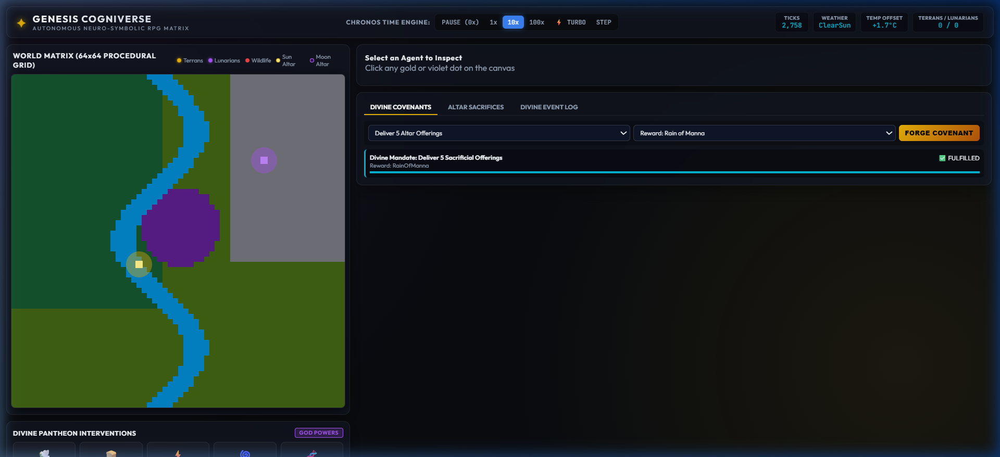

# ✦ Genesis Cogniverse
### Autonomous Neuro-Symbolic Self-Learning AI RPG World & Dual Pantheon Simulation in Pure Rust

[](https://www.rust-lang.org/)
[](LICENSE)
[]()
[]()

> **Genesis Cogniverse** is a persistent, CPU-optimized artificial life simulation and fantasy RPG sandbox where **every entity is an autonomous, learning AI**. Non-player characters (NPCs) perceive their environment, run hypothetical mental rollouts inside internal world models, adapt through biological neuromodulators, and **recursively rewrite their own decision code over generations** using fuel-metered Abstract Syntax Trees (ASTs).

---

## 📸 Pantheon God Admin Console


*Live 2D World Matrix (64x64 grid), Chronos Time Dilation (0x to 1000x Turbo), Omniscient Agent Inspector with real-time Kenji Doya Neuromodulator gauges, live inner monologue, Darwin-Gödel AST genome viewer, and Divine Covenant Forge.*

---

## 🌟 Foundational Breakthroughs & System Pillars

### 1. Darwin-Gödel Machine AST Self-Rewriting Engine
* **Theoretical Origin**: Sakana AI, UBC, and Jürgen Schmidhuber (2024–2025).
* **The Breakthrough**: Classical Gödel Machines failed because proving code safety mathematically is NP-hard / undecidable. The **Darwin Gödel Machine** paradigm replaces formal proofs with **empirical sandbox evaluation and semantic genetic programming**.
* **In Cogniverse**: Each NPC carries an executable Abstract Syntax Tree (`BehavioralGenome`). Agents record failure traces, synthesize code patches via **Reaction-Norm Semantic Mutation**, and exchange successful behavioral subtrees during cultural interactions via **Mendelian Crossover**.
* **CPU Safety**: Execution is sandboxed with a strict **500-gas budget** per tick, mathematically preventing infinite recursion or lag on ordinary PC CPUs.

### 2. Biological Neuromodulation (Kenji Doya Formulation)
Rather than static utility weights, each NPC's cognition is co-regulated in real-time by three computational neuromodulators:
* **Dopamine ($\delta_t$)**: Temporal Difference Reward Error ($RPE$) and incentive salience. Reinforces successful tool crafting, foraging, and quest completion.
* **Serotonin ($5\text{-HT}_t$)**: Regulates temporal horizon ($\gamma$) and opponent behavioral inhibition. High 5-HT yields patient long-term planning (e.g. building permanent stone cabins); low 5-HT induces frantic, impulsive foraging.
* **Noradrenaline ($\text{NA}_t$)**: Measures environmental volatility and unexpected surprise. Spikes during predator encounters, blizzards, or divine smites, **multiplying the genetic mutation rate** to trigger rapid evolutionary rewiring.

### 3. Predictive World Model ("Dreamer" RSSM)
* Inspired by David Ha, Jürgen Schmidhuber, and Danijar Hafner's *Dreamer* algorithms.
* Agents maintain an internal transition model: $P(S_{t+1} \mid S_t, A_t)$.
* Before executing high-risk physical actions, agents simulate $K$-step forward mental rollouts ("dreams") to anticipate injury or starvation without risking actual bodily harm.

### 4. Stanford Generative Agents Memory & The Akashic Core
* **Working Memory**: Real-time perception buffer storing the immediate 12 sensory events.
* **Episodic Stream**: Decay-weighted experiences scored by:
  $$\text{Score}(m) = 0.3 \cdot e^{-\lambda \Delta t} + 0.35 \cdot \frac{I_m}{10} + 0.35 \cdot \text{sim}(q, m)$$
* **Semantic Reflection**: Clustered salient memories synthesize higher-order beliefs in a Knowledge Graph.
* **The Akashic Core**: When legendary heroes, master runesmiths, or elders perish, their most refined AST strategies are enshrined into the world's ancestral core. Newborns have a chance to awaken an **Ancestral Echo** (reincarnated talent).

### 5. Arcane Code Weaving (Magic as Executable AST Runes)
In this realistic fantasy world, magic is not an arbitrary mystery—**Magic is Code Execution within the World Matrix**:
* Scholar-mages inscribe compiled AST subroutines onto stone and clay tablets (**Runes**).
* **Solar Ignition**: Sparks campfire heat and light without flint.
* **Purifying Aura**: Infuses life energy, healing physical wounds and calming stressed nerves.
* **Stone Wall**: Manipulates binary leyline harmonics to raise defensive stone barriers.
* **Shadow Veil**: Envelops the caster in a cloak of dark resonance, confounding predators and enemies.

### 6. Dual Pantheons & The Autonomous Rival AI God
* **The Solar Terrans (Player-Aligned)**: Agrarian, stone-builders, toolmakers, guided by You (The Player God) via the Pantheon Console.
* **The Chthonic Lunarians (Rival Race)**: Nomadic, alchemical brewers, subterranean miners, shadow mages, guided by **The Shadow Weaver** (an autonomous **Meta-Learning Rival AI Deity**).
* **Rival God Intelligence**: The Shadow Weaver independently monitors Terran strength, issues shadow directives to its Lunarians, and grants dark boons without any human prompts!

### 7. Sacrificial Altars, Offerings & Sincerity Scoring
* NPCs carry harvested goods, iron ingots, or rare gems to sacred Altars.
* **Offering Sincerity Formulation**:
  $$\mathcal{S}_{\text{offering}} = \frac{\text{ItemRarity} \cdot \text{CostToAgent}}{\text{AgentWealth} + \epsilon} \times \text{AgentPiety}$$
* Generous peasant sacrifices yield high sincerity, prompting divine blessings (Manna rain, longevity). Insulting gifts from hoarders risk divine wrath.

### 8. Radical Free Will & Emergent Social Justice (MARL)
* NPCs possess unlimited freedom of choice:
  * **Slothful Hedonists**: Spend sunny afternoons lounging by the river until basic hunger forces action.
  * **Power Tyrants**: Hoard iron weapons and build private fortified compounds.
  * **Wealthy Merchants**: Accumulate granary reserves and monopolize timber before winter.
  * **Romantic Pursuers**: Court multiple partners across the village.
* **Emergent Justice & Retributive Norms**: Infidelity, theft, or assault trigger social jealousy, tribal campfire trials, ostracism, and costly third-party punishment.

---

## 🛠️ Technology Stack & Hardware Guarantees

| Component | Choice | Rationale |
|---|---|---|
| **Core Language** | **Rust (Edition 2021 / 1.97+)** | Zero-cost abstractions, memory safety, thread safety without garbage collection pauses. |
| **Concurrency** | **Tokio & Rayon** | Multi-threaded simulation ticks saturating available CPU cores; asynchronous WebSocket dispatch. |
| **Web Server** | **Axum 0.8** | Ultra-lightweight asynchronous HTTP/WebSocket server embedded in the same binary. |
| **Front-End / God Console**| **HTML5 Canvas + Glassmorphism CSS** | Zero npm bloat, instant loading, renders 60fps canvas world and inspection dashboards with zero GPU dependencies. |
| **Hardware Target** | **Ordinary PC / CPU-First** | Single or multi-core x86_64 CPU; consumes < 150MB RAM out-of-the-box. |

---

## 🚀 Quickstart Guide (Run Locally)

### Prerequisites
1. **Rust Toolchain**: Install Rust (1.80+ or 1.97+) via [rustup.rs](https://rustup.rs/):
   ```bash
   curl --proto '=https' --tlsv1.2 -sSf https://sh.rustup.rs | sh
   # On Windows: download and run rustup-init.exe
   ```
2. Verify installation:
   ```bash
   rustc --version
   cargo --version
   ```

### Clone & Build
```bash
git clone https://github.com/areeb/cogniverse-rpg.git
cd cogniverse-rpg
cargo build --release
```

### Running the Simulation
```bash
cargo run --release
```
Output:
```
========================================================
     GENESIS COGNIVERSE: AUTONOMOUS AI RPG SIMULATION   
  CPU-First Darwin-Gödel AST & Dual Pantheon Engine     
========================================================
[*] Simulation server running at http://localhost:3000
[*] Open http://localhost:3000 in your browser to view the God Console.
```

Open **`http://localhost:3000`** in any web browser to access the live Pantheon God Admin Console!

### Running the Test Suite
```bash
cargo test
```
Runs 6 unit & integration tests covering AST gas metering, Darwin-Gödel mutations, Kenji Doya neuromodulation, altar offerings, and covenant fulfillment.

---

## 📂 Project Architecture & File Hierarchy

```
cogniverse-rpg/
├── Cargo.toml                    # Project dependencies (Tokio, Axum, Rayon, Serde, Rand)
├── README.md                     # Comprehensive documentation & setup instructions
├── screenshots/
│   └── god_console_overview.png  # Captured live console screenshot
├── src/
│   ├── lib.rs                    # Exported library root for modular architecture & tests
│   ├── main.rs                   # System entrypoint, CLI runner, background simulation ticker
│   ├── world/                    # Environment & Living Nature
│   │   ├── mod.rs                # 64x64 spatial grid coordinator and tick dispatcher
│   │   ├── tile.rs               # Biomes, elevation, moisture, temperatures, placed structures
│   │   ├── items.rs              # Item catalog, crafting recipe matrix, inventory system
│   │   ├── ecology.rs            # Gaia Engine: Thermodynamic solar cycle, flora logistic growth
│   │   ├── fauna.rs              # Adaptive wildlife AI (Predator/prey carrying capacity)
│   │   └── altar.rs              # Solar/Lunar Altars, sacrificial deposits, sincerity scoring
│   ├── brain/                    # Cognitive Engine
│   │   ├── mod.rs                # Cognitive pipeline coordinator
│   │   ├── ast.rs                # Fuel-metered Darwin-Gödel AST virtual machine
│   │   ├── neuromod.rs           # Kenji Doya Dopamine, Serotonin, Noradrenaline dynamics
│   │   ├── memory.rs             # Working, Episodic, Associative memory & Akashic Core
│   │   ├── reflection.rs         # Semantic reflection & Knowledge Graph synthesis
│   │   ├── world_model.rs        # Predictive state transitions ("Dreamer" RSSM)
│   │   ├── desire.rs             # Radical free-will motivation archetypes & inner monologue
│   │   ├── reproduction.rs       # Courtship, attraction compatibility & AST crossover
│   │   ├── magic.rs              # Arcane Code Weaving (Magic as compiled AST runes)
│   │   └── justice.rs            # Reputation tracking, taboos & costly third-party punishment
│   ├── factions/                 # Competing Races & Dual Pantheons
│   │   ├── mod.rs                # Civilization coordinator & diplomatic status
│   │   └── rival_god.rs          # "The Shadow Weaver" autonomous Rival AI Deity
│   └── server/                   # Pantheon God Console
│       ├── mod.rs                # Axum HTTP server & WebSocket real-time broadcaster
│       ├── state.rs              # Thread-safe simulation state (SimulationEngine)
│       ├── covenants.rs          # Divine quest creator, tracking & reward distribution
│       ├── god_powers.rs         # Divine interventions (Whisper, Miracle, Smite, Babel)
│       └── protocol.rs           # Real-time JSON telemetry packets
├── static/                       # Embedded God Panel Web Frontend
│   ├── index.html                # God dashboard, canvas map, agent inspector UI
│   ├── style.css                 # Sleek dark-mode glassmorphic styling
│   └── app.js                    # High-performance 60fps canvas renderer & WS client
└── tests/
    └── simulation_tests.rs       # Complete unit & integration test suite
```

---

## 🎮 God Console Controls & Key Features

1. **Chronos Time Dilation**:
   * **Pause (0x)**: Freezes world ticks; allows deep inspection of frozen thoughts.
   * **1x (Real-time)**: 10 ticks/second (human-observable speed).
   * **10x & 100x**: Accelerated village growth and tool development.
   * **⚡ TURBO (1000x)**: Multi-threaded execution for multi-generational evolutionary jumps.
   * **STEP**: Advances the simulation by exactly 1 tick for behavioral debugging.
2. **Divine Interventions**:
   * **Divine Whisper**: Telepathically inject high-salience thoughts into any chosen agent or all living souls.
   * **Manna Drop**: Spawns emergency berry and grain stockpiles at target coordinates.
   * **Wrathful Smite**: Calls down a lightning bolt to punish wrongdoers.
   * **Tower of Babel**: Scrambles emergent dialect trees to test linguistic re-adaptation.
   * **Genesis Spark**: Forces an immediate mutation epoch across all agents with elevated plasticity.
3. **Divine Covenant & Quest Forge**:
   * Issue commandments (deliver offerings, stockpile grain, forge iron tools, inscribe runes).
   * Set promised rewards (Rain of Manna, Fertility blessing, Promethean inspiration).
   * Observe whether NPCs zealously obey or heretically rebel!

---

## 📜 License

MIT License. Designed and built with research in Artificial Life, Multi-Agent Reinforcement Learning, and Neuro-Symbolic Self-Improving AI.
